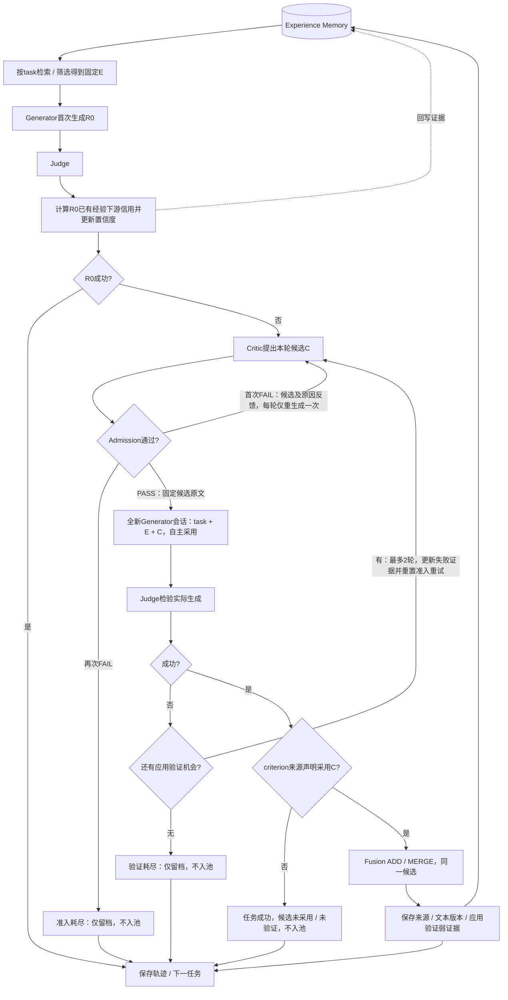

# Critic候选经验准入与新会话验证

## 1. 状态与授权

- 分支：`feat/critic-experience-validation`，起点`7ab9bdc`；main与历史实验保留。
- 状态：**代码、配置、轨迹和Web已按“开始实现”授权落实，230项离线测试通过**。用户随后授权旧日志清理及代码提交；不启动付费实验或push。信用为无折扣、正负分别累计，旧基线/main与历史数据保持。
- 基线：同会话修订→成功后Reflector提炼→Admission→Fusion。473项离线测试属于该基线，不是新机制验收。
- 动机：计划30显示输入去重生效，但公开泄漏35/47、评分机制误解、无依据要求与负向问题假成功未解决。转向新机制是改善检验对象和可审计性，不宣称成功率必然上升。

## 2. 已确认决策

1. Critic在生成前提出0–1条候选content/trigger，私有analysis单独留档；不再给Generator普通修订建议。
2. Admission紧随Critic，FAIL候选不能进入Generator。第一次拒绝把候选和具体reason反馈同一个Critic，允许重生成一次；再次拒绝结束本任务。
3. 最多两轮应用机会，每轮独立拥有一次准入拒绝重生成机会；正常业务由首轮实际应用后的有效Judge失败进入下一轮。格式/结构耗尽按既有无效轮处理，可在剩余预算内继续，但不伪造Judge失败、不新增额度。Critic业务生成最多4次，应用生成/Judge最多2轮。
4. 每次通过准入后冻结候选原文，Generator新建会话，只接收task、原有所选经验E和本轮候选C。E列表及文本固定，不再次检索/筛选；不输入旧rubric/分析/会话、私有判断、偏好对或普通建议。
5. Generator自主决定采用E/C、组合或忽略。使用权限平等，证据状态不同；C无历史confidence，不因来自Critic就强制采用。任务约束始终优先。
6. 第二轮候选替换前一候选，不默认累积。Critic读取上一条通过候选、实际应用rubric、Judge与采用标记，不以旧analysis替代证据。
7. 只有准入PASS、声明采用C且Judge成功的同一候选可Fusion。成功未采用C是任务成功，但C未验证、不入池；不为验证C强行继续。
8. 未采用且失败可以反馈Critic，但不直接说明C无效。准入拒绝、应用失败、未采用和技术错误分开记录。
9. 成功后不调用Reflector，不重新提炼经验，不再Admission。Fusion默认ADD，只对同一设计问题的等价指导/必要细化且条件兼容才MERGE。
10. R0已有经验下游信用在成败分支之前立即回写；引用且P+N>0才更新，alpha加P、beta加N；净方向为0仍可能更新。R1/R2再引用E不重复记本样本下游信用，后续失败不回滚R0。
11. 来源标注是模型自报，不是因果证明。候选与R0统一用来源局部正负证据P/N更新Beta，无lambda或margin增益；不先抵消，只有P=N=0不更新。整体成功仍可有负证据，净方向不决定入池资格。
12. 正向Boolean问题、1–10任务重要性、Judge评分机制不变；不增加语义审核门禁、额外角色或自动内容过滤。
13. 删除无经验诊断模式及experience_enabled开关，不保留普通对话修订分支或另设隐含诊断。空池/Selector未选经验仍执行完整新机制，held-out仍按冻结评价边界执行。
14. 技术错误沿用既有有限纠错及样本/无效轮隔离：格式、类型、引用等错误不能让整个实验终止；保留真实阶段，不伪造判断。鉴权/网络服务、数据/存储及程序异常仍沿既有全局故障策略处理。
15. 不兼容旧运行协议、提示词版本、轨迹字段或Web视图，也不迁移旧检查点。历史main和运行目录保留，不要求新代码加载它们。

## 3. 整体流程（一个应用流程、两层循环）



训练结束冻结Memory及Beta，held-out仅检索/筛选、R0生成/Judge。图表示正常业务，有技术错误时按既有隔离在预算内继续/结束样本，不伪造Judge。应用信用已确定为下节的无折扣正负双通道，代码已实现，真实效果未验证。

## 4. 采用记录与来源协议

采用资格按至少一条criterion的source_experiences引用本轮C判断，保存引用标准ID。analysis供人工复核，不新增“采用审核”模型，也不把ID合法等同语义归因正确。

历史基线用revision_number在编号反解前清空修订来源；**新实现已移除该路径**，遵守以下边界：

- 移除旧同会话修订的来源清空路径，不保留兼容分支；新协议保存原始输出、解析结果和有效来源；
- 每次应用独立编号E和C，严格白名单反解，内部经验ID与候选ID可区分；
- 未知/重复引用仍拒绝，R0仍只允许E，不增加全局未知ID绕过；
- E标记和C标记分别留档：E在应用中的引用只审计，C采用决定验证资格；
- 被拒候选、前轮候选、融合后最终经验ID不得被当作本轮输入引用；
- 0来源/0采用是合法结果，不要求模型假装使用C。

## 5. 轨迹语义（已实现字段见工程设计第9节）

| 必须能还原的内容 | 语义 |
|---|---|
| 原始E及R0/rubric/Judge | 固定输入和已有经验信用来源 |
| 应用轮次与候选生成序号 | 区分最多2轮、每轮最多2次 |
| 每个候选ID/content/trigger | 冻结版本，重生成不能覆盖原候选 |
| Critic实际输入、analysis、输出 | 私有诊断与公开候选分离 |
| 每次Admission decision/reason | 拒绝对象与反馈原因对应 |
| 各Generator独立会话 | task+E+通过候选，证明没有旧历史输入 |
| 有效rubric及C/E来源、采用标记 | 区分提供与采用，保留模型自报性质 |
| Judge或明确错误 | 不伪造未知判定 |
| 成功与入池资格 | 准入拒绝/验证失败/未采用成功分别记录 |
| Fusion结果及文本历史 | 关联实际被验证候选，不事后替换 |
| 请求/结构纠错计数 | 与业务候选生成次数分开 |

新轨迹直接使用新语义，不复用reflected_candidates等旧字段伪装候选来源，不提供历史解码/迁移。最终字段名、临时ID、独立生成与错误终态在实现时按本表定义，Web只读取新方案产物。旧目录保留、不补造新状态；不再为旧日志可加载性增加测试或代码。

## 6. 信用规则：无折扣、正负分别累计（已确定）

- [x] 保留Beta(1,1)基础和confidence=alpha/(alpha+beta)。
- [x] R0已有经验与本轮候选统一按实际引用标准计算P/N，不使用lambda或独立会话margin增益。
- [x] 正向与负向分别累积，不先抵消；净方向U=P−N仅供展示，P+N=0才不更新。

```text
P_R(e) = Σ_{i:e∈S_i} [ ω_i(R) × max(d_i, 0) / |S_i| ]
N_R(e) = Σ_{i:e∈S_i} [ ω_i(R) × max(-d_i, 0) / |S_i| ]
alpha += P_R(e)
beta  += N_R(e)
U_R(e) = P_R(e) - N_R(e)  # 仅展示，不作更新量
```

d_i为两侧Boolean判别差，S_i为标准声明的来源，多来源均分；P/N非负，P+N≤1。不打折、权重固定1，标准d=0不视为负证据。已有经验只在R0回写，应用里的E引用不重复记账；候选只计算本轮实际应用，不跨候选版本混账。

保持入池资格PASS+采用+整体成功不变，整体成功不意味着候选只有正证据，净方向≤0不额外改变资格。ADD从(1,1)更新；MERGE在目标原Beta追加P/N并保存版本和来源。失败候选不入池，P/N仅留轨迹诊断，不扣给不相关池经验。

举例：+0.2与−0.2令alpha/beta各加0.2；+0.3与−0.2分别加0.3/0.2，不能只加净+0.1；只有+0.2只加alpha。双通道均0才不更新。若初始(1,1)，第一种confidence仍0.5，累计证据强度增加0.4；其他初始比例会被均衡证据拉向0.5。

累计强度A=alpha+beta−2，增量P+N，不是|P−N|，也不是独立任务数。新证据存positive_credit/negative_credit，不再只存净credit；展示可派生U。Beta仍是分数证据的平滑累计，不是严格校准概率；统计背景见[Stanford CS109](https://chrispiech.github.io/probabilityForComputerScientists/en/part4/beta/)，规则详见[可靠性模块](../设计方案/11-可靠性更新与噪声证据.md)。

### 已确定的工程边界

- 无经验诊断及开关删除，不保留替代旧分支。
- Critic/应用Generator格式耗尽保留无效轮，既有剩余业务机会内可继续；有限结构纠错不扩大轮数。R0生成、Selector、Admission、Fusion等角色契约耗尽记录sample_error并继续下一样本。Judge输出耗尽记录judge_error并结束该样本后续流程。技术错误不伪造PASS/FAIL或经验验证。
- 后端格式纠错耗尽不再叠加额外格式重试；网络/鉴权等全局故障、Calculator/Memory/索引/轨迹、数据或未知程序异常继续沿现有fail-fast边界，不泛化为吞掉所有异常。
- 不兼容旧字段、角色、配置、方法版本或Web日志；旧检查点拒绝，历史目录不删除/回写。工程命名实现时落实，不再作为旧协议迁移待定项。

方法决策和代码实现已落实。付费实验的目录、规模、对照和预算另行授权，不自动再跑100条或全456条。

## 7. 已实施代码改动范围

保持verge源码扁平，无新服务或框架。

| 文件 | 实施内容 |
|---|---|
| verge/models.py | 新候选/应用/采用/错误/入池轨迹，删除旧操作和反思协议，不做历史解码 |
| verge/config.py | 新版本、两层有限预算，删除experience_enabled及旧诊断策略 |
| verge/prompts.py | Critic候选输出、拒绝原因反馈、独立Generator输入与角色专属输出要求 |
| verge/modules.py | 新角色契约、独立生成接口、E+C严格来源反解，移除旧来源清空 |
| verge/pipeline.py | 两层业务循环及成功/未采用/准入耗尽/验证耗尽分流 |
| verge/calculator.py | R0与候选P/N分别累计、无折扣Beta更新；净方向只展示，双通道均0不记账 |
| verge/memory.py | 只有合格验证候选才写入，版本和证据关联 |
| verge/cli.py | 装配新策略，旧配置不可误执行新机制，manifest与新目录要求 |
| verge/web.py、web_assets | 只读新轨迹、独立会话与采用/未验证状态，不保留旧版本展示 |
| tests/ | Fake/Mock新流程、边界、来源、证据及错误隔离；移除旧兼容/诊断断言 |

活跃LLM主链为Selector、Generator、Judge、Critic、Admission、Fusion；新代码移除Reflector及旧协议解析/展示。不更改Judge/model/dataset，不创建共享输出协议或共享经验定义块。

## 8. 实施步骤

- [x] 整理用户已确认流程、预算、采用资格、R0更新与冻结边界。
- [x] 更新总览、模块文档、工程约束、README与PLAN，标注目标/实现差别。
- [x] 确认第6节正负分别累计、无折扣及第2–4项工程边界。
- [x] 新领域/配置/角色契约，删除旧诊断与协议；不做旧轨迹读取。
- [x] Critic候选、拒绝原因重生成与Generator新会话来源接口。
- [x] 两层控制、采用分流、弱证据/融合写入及既有错误隔离。
- [x] Web新状态展示，删除旧版本兼容。
- [x] 全套离线验收，Fake端到端和Mock实际消息回放。
- [x] 用户授权清理旧实验日志、忽略生成截图并提交代码。
- [ ] 小规模真实验证须另行授权。

## 9. 离线验收清单

### 控制与预算

- R0成功不调用Critic/Admission/应用生成；R0有P/N证据已更新，包括净方向为0但两通道均正。
- 第一条PASS直接应用；第一条FAIL只重生成一次，并传原候选和对应reason。
- 同轮两次FAIL结束，不进入Generator，不挪用下一轮。
- 正常业务首轮Judge失败进入第二轮；无效轮按既有隔离继续剩余机会，不能伪造Judge失败；重置本轮一次准入重试且总预算不变。
- 第二轮替换候选；最坏4次Critic、4次Admission、2轮应用，不因未采用/模型错误无限循环。
- 第二轮失败、空候选、准入耗尽和技术错误完整留档，无伪造判断。

### 输入、来源与采用

- 每个应用会话实际消息无R0/R1/旧analysis/assistant、偏好对、Judge明细或普通建议；E列表/文本保持不变。
- Admission只含task和当前候选，拒绝反馈进入Critic而非Generator。
- Critic第二轮使用实际rubric/Judge和上一候选/采用记录，前后证据去重，不传旧私有叙事。
- HTTP与Fake均保留E+C合法来源，未知/重复/旧候选引用拒绝；R0未知来源仍拒绝。
- Generator可以自主不采用C；无C且成功结束但不Fusion、不记弱证据、不触发额外验证。
- 无C且失败反馈“未采用”，不能给候选虚构负证据；有C且失败可进入下一轮。
- 同一候选原文从准入到应用到Fusion可逐字核对；重生成采用新ID并保留原记录。

### 记账、错误隔离与评估

- 新候选仅PASS+采用+有效成功+合法Fusion写入；其他情况零候选Memory写入。
- R0正向/负向/双通道均0/未引用、整体成败与证据方向不同均覆盖；后续不回滚，不重复计应用E引用。
- P/N重算：多来源均分、+0.2/−0.2分别增加0.2/0.2、+0.3/−0.2分别增加0.3/0.2、双通道0不更新；证据量增P+N，净方向只展示；ADD/MERGE及成功有负证据均覆盖。
- held-out冻结文本/Beta、无候选调用；空池仍可执行新学习链，旧experience_enabled配置/无经验诊断策略删除。
- 格式/类型/未知引用等耗尽不全局中止；角色sample_error、无效轮、judge_error及全局故障分别覆盖，R0信用不回滚。
- manifest标识新方法/提示词，旧检查点及旧schema明确拒绝；不要求旧Web/trajectory可载入，历史目录哈希不变。
- 无自动语义门禁或额外角色；Mock只验证工程契约，不声称模型泄漏率或经验有效性改善。

## 10. 后续效果评价边界

真实验证获授权后，分别报告：R0成功率、任务救回率、准入首次/重生成通过率、候选提供/采用率、采用后成功率、成功未采用数、入池率、两类耗尽及技术错误。任务成功率不能替代有效经验产率；同序开发复测不作为held-out泛化证明。若将来做“全新会话但无候选”对照或重复采样，需单独设计与授权，不能自动增加调用。


## 11. 实施与验收记录

- 新主链已替换旧Reflector/对话修订；默认Fake及OpenAI/Qwen示例配置改为`modules.application: critic_candidate_validation`。历史实验配置原样保留，新CLI拒绝旧策略/开关/角色。
- 字段与版本见[工程设计第9节](../工程设计.md)：独立`proposal_attempts`/`application_attempts`，声明采用标准ID和双通道Credit，manifest/Memory/trajectory版本2。固定E包含原始文本及使用前证据视图；第二轮替换C。
- 230项测试通过，包含保留的数据准备、网络/鉴权/日志隐私、向量缓存、独立Judge和并行冻结测试，以及新预算、拒绝反馈、严格来源、错误隔离、P=N>0更新、零信用与负信用成功入池、ADD/MERGE版本与续跑边界。旧兼容、Reflector、普通修订和诊断测试已删除或改写，没有skip。
- `tests/test_candidate_http_pipeline.py`用MockTransport走最坏4次候选生成、4次Admission、2轮独立应用，核对实际system/user、前后证据各一次、拒绝反馈、新候选替换、来源原文及最终双通道Memory。无真实API调用。
- 浏览器以临时Fake运行核验概览、样本/角色和经验页，JavaScript错误为0、无横向溢出；局部预览服务已关闭。截图保存在`/tmp/verge-plan31-{overview,sample,memory}.png`，已有output截图未改写。
- 历史25项manifest/Memory/轨迹/角色日志/请求日志SHA256及全量训练数据SHA256核验不变；main仍为7ab9bdc。未提交、未push、未启动付费实验。

这些验收只证明实现契约，不证明候选无泄漏、来源归因正确、Judge判断可靠或经验具备泛化效果。


## 12. 用户授权日志清理与提交

实现验收后，用户要求删除之前的日志、将Playwright截图等生成文件加入gitignore并提交代码。此次清理删除以下5个旧运行目录（各含manifest及实验产物），此前第11节的哈希核验是删除前的实施记录：

- `runs/rewardbench-chat-hard-qwen-revision-only-100`
- `runs/rewardbench-chat-hard-qwen-revision-only-evidence-grounded-100`
- `runs/rewardbench-chat-hard-qwen-revision-only-evidence-grounded-100-resumed`
- `runs/rewardbench-chat-hard-qwen-vector-prospective-experience`
- `runs/rewardbench-chat-hard-qwen-vector-task-grounded-experience`

两个数据目录`rewardbench-chat-hard-data-144x60`和`rewardbench-chat-hard-data-full`保留，5个准备数据文件的SHA256在清理前后相同。历史报告和main保留；`output/`中的本地截图、SVG保留但忽略，额外忽略Playwright的`playwright-report/`、`blob-report/`及`test-results/`。原有`.playwright-cli/`忽略继续有效。

新实现、配置、测试、方法与工程文档以及本次清理记录一并提交到`feat/critic-experience-validation`，不push，不启动付费实验。
