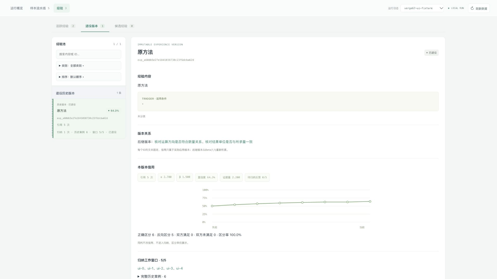

# 计划67：版本演化与混合检索局部验证

2026-10-16。代码已实现，完成离线验证及独立模块复测；没有启动新的真实训练流水线、held-out、提交或清理历史日志。

## 实现

- 新增独立Atomizer；Critic草稿先原子化，Generator一次应用本轮集合，各候选独立引用/P/N，正常收尾选择最新合格轮的全部合格项。
- 经验公开文本按ID固定。Updater保持或修订；修订/拆分产生新ID，父版本退役并保留信用，子版本从Beta(1,1)、空usage/窗口开始。没有信用复制或平分。
- 当前版本每5个新的不同下游有区分任务，使用最近5条正负案例归纳；同判和来源不占窗口，历史不删除，不再10条永久冻结。keep消费窗口，失败同题不重试，新案例推动有限重试。
- 类别文档与活跃成员分别索引。向量＋BM25/RRF，成员映射类别按max聚合，任务Top20单位、归类Top10类别。中文采用固定Unicode单字/双字片段，英文采用casefold词项；RRF k=60、BM25 k1=1.2/b=0.75。
- 归类只修改单个目标；批末CategoryDescriber只修改name/description，失败保留成员及dirty变化；归类与描述不能互相越权。
- Memory7、Manifest/Trajectory9，method=`immutable_atomic_evolution`，Prompt=`immutable-atomic-evolution-hybrid-v1`。新源码拒绝旧协议，不加生产迁移兼容；旧实验文件保留。
- Web支持活跃/退役版本、父子链接、五案例窗口/完整历史、归纳触发任务及类别元数据事件，保留排序、列表滚动和类别专页。

## 确定性验证

`/opt/anaconda3/bin/python -m pytest -q --disable-warnings --tb=short`：334项通过。测试覆盖原有评分/错误隔离及新集合资格、多来源分摊、版本替换/拆分、父账本保留/子先验重置、五案例/同判/失败窗口、归类权限、Top10去重/自身排除、输出字节预算、短ID、恢复与Web。

旧协议的3任务/10条饱和、全池分类、同ID继承等测试按新契约重写，测试数量不能与旧343项直接比较成覆盖增减。新增`scripts/audit_versioned_run.py`独立重算新协议的R0/来源P/N、使用计次、版本出生/退役、窗口和最终账本，离线运行夹具通过；不把旧审计脚本套用到新协议。

JS语法、Python编译、文档链接及diff空白检查通过。最终又补充了分类检索轨迹和短ID映射留档、结构输出100000字节预算及版本关系校验；这些是审计/格式边界加固，未重跑全部模型案例，已用离线HTTP与状态测试验证。

## 独立真实模块复测

产物：`runs/versioned-evolution-module-replay-67/`。固定Qwen3.5-Flash、`enable_thinking=false`，3个独立调用并发；没有PipelineRunner调用、输出串联或源池回写。manifest记录输入转换、源码哈希和保护文件；代码快照分别保存在`code_snapshot`和`atomizer-confirmation/code_snapshot`。原始数据、manifest、Memory、轨迹和角色日志最终SHA256均未变化，凭据泄漏扫描通过。

| 模块 | 首轮输入数 | 有效结构 | 来源与限制 |
|---|---:|---:|---|
| Atomizer | 40 | 40 | 20个真实Critic草稿；20个真实更新输出/来源文本控制，后者含9个明确标注的identity control |
| Updater | 20 | 20 | 20个不同来源任务；仅3组满足同一固定文本版本的完整5案例窗口，另外17组是2～4案例诊断，不能算完整契约验证 |
| 局部归类 | 20 | 20 | 20个来源任务的历史池重建，实际Top10混合召回，无新输出反馈到下一组 |
| 类别描述 | 20 | 20 | 20个不同来源任务；7组实际批变化，其余13组从真实成员/类别派生的单成员变化控制，不是历史Describer实参 |
| Selector | 20 | 20 | 跨运行取固定历史输入；保留旧输出供比较，候选不由本次归类产生 |
| Generator | 20 | 20 | 固定历史真实输入，旧单候选显式转换成一项集合；没有加入本次Atomizer输出 |
| Critic | 20 | 20 | 固定历史首轮输入，避免丢失第二轮真实会话上下文 |

首轮160个案例，实际162份角色HTTP日志（包括有限纠错）；全部结构有效不表示全部语义正确。新角色只有派生输入，没有伪装成历史实际请求。Updater不足20个目标窗口这一缺口仍存在，未复制任务、混用不同旧文本或启动完整训练凑数。

### 原子化复测发现及修正

首轮真实输出出现两类直接问题：

- 单条原子输入也被改写，可能导致每次演化无意义地重建版本。
- 提供旧文本时，原子化器把旧方法重新作为子经验输出。例如`atomizer-24`的修订稿只有“角色能力对应设定”，却又输出旧文本的“先确认身份”；`atomizer-25`又恢复旧大纲规则。这是本次同调用内可见的旧文本回流，不外推为已证明整个系统反复出现的因果链。

因此调整同一Atomizer接口：不再提供旧文本，只给草稿和来源类型；返回一项时程序逐字保留草稿，只有多项输出允许拆解。加入两条原创告警接收对象/时段、任务条件/标记保留示例，不取自数据集。

在同一40条固定输入上独立确认，40/40有效、40次角色HTTP调用：24组返回一条，程序输出全部与草稿完全一致；16组拆分。合计首轮＋确认200个案例、202份角色HTTP日志。原计划180次是初始预算，此次因明确的接口失真追加40条固定对照，记录在确认manifest；不追加无限提示词搜索。

定向语义复核结果：

| 案例 | 观察 |
|---|---|
| atomizer-09 | 确认版正确拆开运算方向/公式关系与单位统一；首轮第一项仍捆绑两动作 |
| atomizer-23/24 | 确认版不再把旧方法追加进新草稿；单项直接保留当前文本 |
| atomizer-37 | 台词精确匹配与标志动作名称分成两条，分别保留条件 |
| atomizer-07/20/27 | 仍将同一方法的正面要求与反面排除拆成两条，属于明确的重复拆分 |
| atomizer-25 | 角色名和动作被分别核验，存在丢失“对应角色做对应动作”关系的风险 |
| atomizer-31 | 场景限定被拆成独立方法，边界是否应独立仍有问题 |

逐项记录在`semantic_review.json`。未裁定项标为待进一步复核，不以16次拆分为成功指标。单项原样保留只保证不被这个角色改写，不能保证输入本来原子或内容正确。

### 归纳和类别质量

Updater首轮8次keep、12次revise；完整五案例3组中1次keep、2次revise。仍有改写偏强的行为：例如第3组新增“不能使用代词”的倾向，实际任务未必要求显式角色名。短窗口诊断第11组trigger收窄为“仅罗列名称”，但正文仍要求对象细节，范围一致性不足。不能据此宣称演化会持续提升质量。

归类结果8次assign、6次create、6次unclassified。请求意图与词形变化、名单同义实体与AI能力边界的例子中，有分别新建/保持未分类的行为，但这是固定历史候选上的局部迹象，不证明新的全池分类已经更准确。

CategoryDescriber接口没有成员操作，20次都返回合法元数据。但第15/16组继续保留“请求意图与词形变化”，第20组继续保留“名单同义实体与AI能力限制”这一不协调范围，说明元数据更新不会自动修复已经错误的成员归属。首版不擅自增加全池重聚类。

## 检索独立对照

`retrieval-comparison/`固定20个任务查询＋20个归类查询，比较同一文档索引上的纯向量排名和加入BM25/RRF后的排名，不同时改变索引组织。使用text-embedding-v4/1024，缓存后72次Embedding请求。

40查询中11个Top5单位集合改变，15个查询完全没有词法命中。任务多为英文而经验多为中文，词法互补不能跨语言自动生效。当前历史池少于20个单位，任务Top20基本完整召回；未建立人工相关集合，不能把排名差异解释为精确率/召回率提升。Top5仅是诊断，不替换正式Top20。

局部归类阶段的Embedding请求未独立配置metadata hook，故上述72次只属于独立检索对照，不是本轮全部Embedding总量；分类阶段保存了实际候选和排名，不能补造其HTTP请求计数。

## 界面验证与限制

使用独立离线夹具，在临时127.0.0.1:8766服务验证：2个活跃子版本、1个退役父版本、同一类别专页、父子链接自动切换页签、5条工作窗口、类别create/assign/describe事件。截图见下图；不是新版真实训练产物。

苹果翻译端点本次返回503，明确提示英语/简体中文语言包不可用；本机权限环境已禁用沙盒，服务仅loopback，因此不能归因于“沙盒运行”。未安装语言包或改动系统设置，翻译正常这一验收未通过。临时验证服务结束后停止，原8765服务不重启。

## 结论与剩余工作

工程机制已打通，旧源产物未改。已观察到原子化接口的局部修正，但重复拆分、必要关系丢失、Updater过强规则及分类漂移仍存在；这些没有用额外准入或信用撤销掩盖。

剩余证据缺口：至少20个真实固定版本五案例窗口、人工相关集合下的检索质量、长期新版本信用积累/选择机会，以及完整链路收益。本轮不把局部结构和离线账本通过解释为方法已有效，也未自动启动新200题实验。
