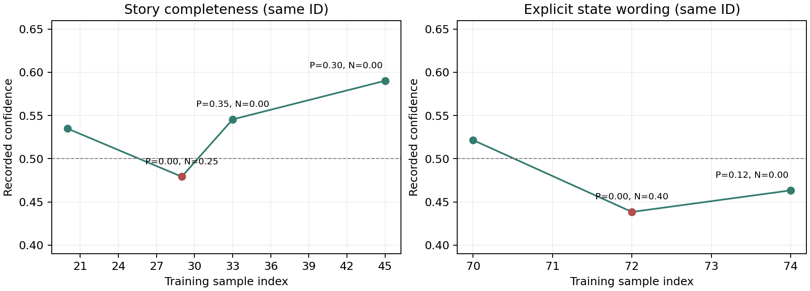

# 经验利用与置信度演化审计

审计支持一个明确结论：正负记账和置信度涨跌机制在执行，负反馈没有被忽略。尚未有足够证据判断“好的经验最终高置信、差的经验最终低置信”已经形成。本次最突出的限制是持续验证覆盖少、方法文本经常变化，而不是必须先消除Judge误判。

用户2026-10-14明确设想：允许错误经验和判断噪声，依靠后续使用逐步检验并调整信心。本次以这个目标审计，单次错误、单次正信用或一次整体失败不作为机制失败；既不撤销信用，也不新增审核角色或修复Judge。没有新模型调用、完整流水线或经验池写入。

## 范围与可复算检查

来源为现存100条真实训练轨迹，`helpsteer3-general-split-experience-qwen-flash-100-resume3`。此运行使用计划49的原历史Prompt，不把计划59的重放结果当作后续真实使用，也不跨协议续跑。全量还原67个经验ID的出生、选中快照、信用、文本版本、更新及父子关系；重算159份有效Judge合并结果、64份实际记账信用以及候选资格。最终Beta、各版文本、案例归属和证据历史与原池一致，拆分及最终活跃池P/N守恒。

语义复核45次事件：全部13次原题入池、20次分布于16个不同任务的净正向下游信用、全部12次净负向信用；合计36个不同任务。20次正向事件覆盖4个实际获得反馈的家族及早中晚阶段，不能叫20条独立经验或20个独立任务。另19次正向事件只检查数值和演化，不虚称语义全量。专业事实、主观粒度或上下文有歧义的项目标为未知；没有整体经验质量金标或盲评。

源manifest、原始数据、轨迹、经验池、角色日志、调用元数据、生产代码和AGENTS指纹在审计前后保持。审计程序只用只读Memory和内存演化，不写原池。记录见[audit_manifest.json](audit_manifest.json)、[summary.json](summary.json)和[additional_metrics.json](additional_metrics.json)，复核见[事件复核](事件复核.md)及[完整原文卡片](review_cards.json)。

## 1. 后续利用确实能让信心下降和回升

| 观察 | 数量 |
|---|---:|
| 最初入池经验 | 13 |
| 数值下游信用事件 | 51（来自35个不同任务） |
| 净正向下游事件 | 39 |
| 净负向下游事件 | 12 |
| 负反馈后置信度下降 | 12/12 |
| 同一ID获得过两种方向的下游反馈 | 9 |
| 最终活跃经验置信度低于0.5 | 2 |

全部下游净负事件本次均为P=0、N>0，所以均降低confidence；39次净正事件本次均上升。一般而言，P>N不数学保证任何原比例必升，要比较新证据正向占比与原比例，本报告只描述实际这批事件。

真实序列一：经验`exp_71dc77f6c81544d5a21d9d86af6b036f`核验故事完整性。

- 第20题拆分出生：confidence 0.5349。
- 第29题：A拒绝续写、B有完整过程；来源标准方向支持B，N=0.25，降至0.4792。
- 第33题：A包含收鱼烹饪的指定结局、B未完成结局；P=0.35，回升0.5455。
- 第45题：P=0.30，升至0.5902，然后拆分。

这说明可以出现“先负、后正”，并非只奖励不会扣分。第33题后文本改为v2，第45题又拆分，所以整个序列也不能当作固定不变方法的长期收敛证明。

真实序列二：经验`exp_f48fd0d724814f65bea334f204bd50bd`强调结果状态显式表述。

- 第70题拆分出生：confidence 0.5215。
- 第72题用于原创韧性隐喻，标准把显式受压→恢复形态作为硬要求，A多种意象不全部满足而B橡皮筋满足，N=0.40，降至0.4384。
- 第74题要求具体角色的脸红、心形瞳孔，A正确角色发生、B写到另一角色；P=0.1167，回升0.4633，但仍低于0.5；此后改为v2。

该例允许看到同一方法在不合适迁移与明确状态核验上的不同反馈，具有用户设想的局部行为；它不是该经验在所有场景均正确或错误的证明。

图仅连接实际出生和信用点；左图33后改写、45后拆分，右图74后改写。分差按记录判断，未通过额外模型重新评估。

## 2. 大部分经验还没有获得持续的新证据

13个根经验家族中，仅4个获得过新的数值下游反馈；家族合并统计后仍如此，避免将拆分后的新ID误算成完全没有历史。

| 来源题 | 原方法概括 | 家族数值事件 | 不同下游任务 |
|---:|---|---:|---:|
| 11 | 实体存在性与知识边界 | 8 | 7 |
| 19 | 背景呈现，后续扩为多个叙事方法 | 35 | 24 |
| 31 | 合理推断、信息局限 | 7 | 7 |
| 57 | 语义歧义 | 1 | 1 |

这些任务数在不同家族间有重叠，不相加当作独立任务总数。第19题家族占35/51次信用，验证分布明显集中。其余9个家族有的题型未再出现，有的没有被引用，有的引用后两答同判，不能一律说“Selector阻止验证”或“经验错误”。

按活跃ID看，40条中38条没有本ID出生之后的新数值反馈；不少有父经验继承信用和历史案例，因此不能说38条从未获得任何支持。即便排除很晚出生者，出生于第80题或更早的16条活跃经验中，15条仍无本ID新数值反馈。它们不一定都有适用的新题，这个统计不能替代适用性检查。

完整生命周期包括173次选择、140次引用，其中89次引用两答同判。另31次有效Judge下的选择未引用，2次选中后Judge结构无效。无数值证据的情况均按现有设计不更新Beta：没有将未知当成负反馈。

例如第28题“简短背景允许概述”经验，之后选中8次、有效引用5次，5次均无区分；conf从0.5238保持。第61题含否决片段的经验，后来只用于词数项，两答false；第84题游戏语境经验，后来用在二设比较题，两答false。它们没有得到“涨/跌”信号，不能借高于0.5的出生分数宣称后续已通过验证，也不能据此断言它们坏却永远不降。

## 3. 文本更新和拆分使验证对象持续变化

39次归纳包含27次拆分和12次同ID写入，其中10次实际改变文本、2次保持。每个新正向案例立即触发归纳，正在累计的往往是方法家族及历史版本的表现，而不是同一固定文本的反复表现。

27次拆分产生54个子ID，全部子经验出生conf低于其父拆分前conf；这是本次证据分配和每个子经验重新加Beta(1,1)的结果，不是Judge新给了54次负反馈。正负数值均守恒，最终活跃池合计P=16.52、N=3.255，等于64次实际记账之和，没有丢弃负信用或重复计入原题信用。

继承P/N合理地延续家族历史，但它不自动认证子文本的新边界。案例所体现方法变化也能使引用信用与最终文本不完全对齐：

- 第50题“对话与背景区分”被引用到短裙等具体情节项，P=0.17；随后拆出“严格关键修饰词”方法。不是重复检验同一动作。
- 第66题“冷门实体存在性”被引用到logo文字描述/组合，P=0.30；随后拆出视觉描述方法。这一正信用不能直接认证实体不存在性规则。
- 第82题原叙事完整性方法迁移到故事总结，A对结局和人物状态较准确、B错置交易者并误报结局；归纳单列摘要方法。这里有真实方法扩展，不能一概判作漂移错误，但仍需要后续针对新方法的观察。

所以“38条活跃ID没有新反馈”不能证明拆分机制有害，家族已经有一定使用；同时，家族有反馈也不能替代每个新文本的再利用。两种口径需要一起看。

## 4. 允许噪声有实际空间，但好坏最终分化仍未被验证

语义审查既看到清楚支持，也看到弱归因和疑似误判。例如第33题必要结局核验、第53题是否观看正确战斗录像、第74题执行者与状态归属、第82题故事结局复述，都有可直接定位的任务/回答依据。

同时，第42题B从未声称TREE(3)最大或无限，却在“是否避免该错误断言”项被判false，正信用被归给信息局限方法；第78题B已有多回合、胜负和尾声，Judge却因缺叙事深度否定“完整性”，与经验只看核心缺失的边界不一致。这些是局部含噪证据，不因此取消经验或要求新增正确性门禁。未核实专业事实及叙事粒度含混项按未知处理，不给全局好坏标签。

尤其需要纠正我之前关于“100项→精选”的说法。实际第93题候选同时得到P=0.35、N=0.30，仅净正0.05，出生conf为0.5094；其后第97题视频任务引用一次条件项，两答true，P=N=0。此经验没有再次获得正信用，也没有归纳更新。因此这条具体经验不存在此前未经核实宣称的持续正向强化链。全部完整原文和各标准依据见复核卡片45与exposures.json。

本次没有把所有经验预先标成好/坏，只有35个任务产生下游数值证据，又存在方法版本变更、来源共享和案例重叠，尚不足以评价最终质量排序。confidence是加权证据分数，不是经验证的有效概率。

## 建议的下一步

保留正负累计和允许噪声的设想。下一步优先给方法一个较稳定的后续观察窗口，验证能否积累更多不同任务的支持和反对，再决定更新与拆分时机；例如可讨论暂缓改写/拆分、先保留文本累计信用的有限对照，而不是继续搜索提示词或要求Judge先无误。具体窗口、预算和实现尚未确定，本次未更改机制或启动新实验。

无引用、无区分的记录继续按未知处理，并展示每条经验的实际下游任务数；不因为缺少证据强迫在无关题上使用。来源验证、继承信用和新文本反馈应在分析中分别说明。

“最终高置信”还需要足够证据强度：假设从Beta(1,1)开始，每次只得到P=0.2、N=0，10次后conf=0.75、20次后约0.833、40次后0.9。这只是公式示例，不是本run实际结果；低于0.9不能自动解释为经验差。本次真正观察到的是信用会随表现变化，尚未观察到足够成熟的经验质量分化。
