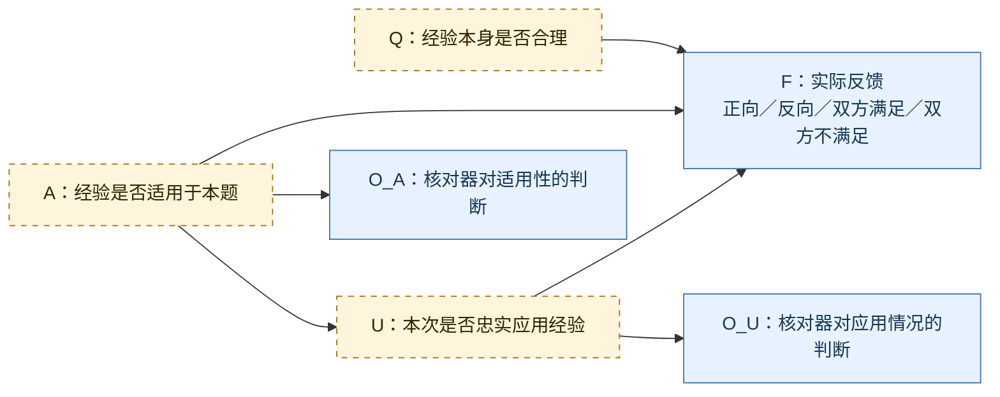

# VERGE：经验模板、持续演化与贝叶斯网络完整设计草案

创建：2026-10-17 · 本轮更新：2026-10-20 · 状态：讨论中，未实现

本文是覆盖完整方法的共同修改入口，包含继续沿用的现有机制、已确认但未实现的调整，以及尚待验证的贝叶斯网络方案。它记录已认可的方向、建模草案和未解决的问题，不替代[当前设计方案](设计方案.md)，不代表已授权实施或实验。这里的贝叶斯网络是根据讨论提出的研究设想，不宣称就是涵哥的原始方案。

## 阅读导引：先理解这套方案想做什么

贝叶斯网络是在描述若干不确定事情之间的概率关系，并利用看到的线索更新判断。可以先记住一句话：**原来的判断＋新证据，通过概率关系计算，得到更新后的判断。**

例如，看到地面湿了，可能是下雨，也可能是洒水器工作。再看到洒水器正在运行，会改变我们对“是否下过雨”的判断，但不直接证明没有下雨。这个例子只解释推断思路，不是本项目的网络结构。

对应本项目：看到反向反馈，可能涉及经验缺陷、不适用、应用偏离以及评价噪声。**目标不是再造一个会涨跌的分数，而是研究能否利用额外证据，部分区分这些解释，为修改经验提供依据。**目前尚未证明能做到。

| 概念 | 通俗解释 | 本项目中的例子 |
|---|---|---|
| 节点 | 要考虑的一件不确定的事情 | 本次是否正确应用经验 |
| 箭头 | 模型假设哪些变量直接参与另一个变量的概率计算 | 应用情况参与反馈概率计算 |
| 先验 | 看到本次证据之前的判断 | 本次用错的初始可能性 |
| 条件概率表 | 在指定情况下，各种结果多常发生 | 实际用错时，核对器多常报告用错 |
| 证据 | 本次真正记录到的结果或报告 | 反向反馈、核对器的报告 |
| 后验 | 结合证据后更新的判断 | 收到报告后，本次用错的可能性 |
| 校准 | 检查输出概率是否与实际核验频率相符 | 被预测为80%可能用错的一批案例，实际是否约80%用错 |

**先验和条件概率不是同一种东西，也不都是模型现成提供的数字。**它们可以参考历史核验数据估计；未经核验的运行日志并不自动包含真实状态。

阅读顺序：第3节看完整流程，第4—7节看经验、检索、评分与信用，第8—9节看贝叶斯网络及参数，第10—12节看演化、分类与工程，第13节看贯穿案例。不会公式也可通过第8.5节的普通算术例子理解。

## 1. 要解决什么问题

目标是通过后续应用，逐步改进经验的适用条件和方法内容，而不只是改进经验检索或给 rubric 学习权重。

当前主要困难：

1. **结果不能直接说明经验质量。** 经验经过选择、应用和 Judge 评价后才得到反馈；方法错误、误用和评价噪声可能产生相同结果。
2. **单个信用分数混合了不同原因。** 继续累计反馈是否能区分这些原因，需要验证，不能预设次数多了自然会准确。
3. **缺少明确的修改依据。** 得到反向反馈后，应修改 trigger、模板内容，还是应用方式，需要具体证据。

接受经验和 Judge 存在噪声，不要求先消灭所有错误，也不因为单次失败就删除经验。

### 已核对的现有基线与证据边界

- 只有被标准实际引用的经验才计算相应信用。
- Judge 输出通过有效性检查后才计算反馈；无有效结果不作为经验负反馈。
- 正向、反向、双方满足、双方不满足已经分别记录；同判当前不加减信用。

这些不是新方案的创新点。代码入口见 [calculator.py](../verge/calculator.py)、[pipeline.py](../verge/pipeline.py)，现有信用定义见[可靠性文档](设计方案/11-可靠性更新与噪声证据.md)。

本次对照基线为计划68实现及计划69完整实验；当前实现入口为 [pipeline.py](../verge/pipeline.py)、[memory.py](../verge/memory.py)、[modules.py](../verge/modules.py)。部分子文档页首仍记“最近实验为计划66”等历史状态，实验索引以 [PLAN.md](../PLAN.md) 顶部为准；方法规则以当前代码及计划68为本次核对依据，不照抄过期页首。

基线只说明机制存在，不证明经验质量、首轮正确率提升或归因能力。本文不把旧实验结果作为新版模板或网络的验证结果。

## 2. 当前讨论结论

| 事项 | 状态 | 内容 |
|---|---|---|
| 经验模板 | 用户认可的方向 | 一条经验包含适用条件、一个原子核验操作及任务参数 |
| 候选单独应用 | 用户提出、按此写入草案 | 首次使用任务＋E；候选验证用新会话，仅输入任务＋C，不继续提供 E |
| Judge 调用 | 已确认保留 | 同一套标准分别独立评价两个回答，不提供偏好标签 |
| 经验间依赖 | 暂缓 | 本阶段不研究经验之间的依赖、组合参数或全池关系学习 |
| 贝叶斯网络 | 明确研究方向 | 用于经验认识与演化；不以“学习评分权重”替代这个目标 |
| 应用核对器 | 有争议，未确定采用 | LLM 核对只能提供可能错误的判断，不能直接作为真值 |
| 概率表、先验与校准 | 未确定 | 尚无可支持可靠诊断的已估计参数或校准数据 |
| 概率更新方式 | 已确认采用逐次更新 | 同一经验版本内，上次后验结合新证据继续更新；保留完整证据，支持批量重算 |
| 自动演化规则 | 未确定 | 触发、采用门槛、版本信用衔接仍需讨论 |

### 2.1 完整方案的保留、调整与待定边界

| 模块 | 本草案的处理 | 当前实现与目标差异 |
|---|---|---|
| 偏好数据、顺序训练与冻结评价 | 沿用 | task用于生成；偏好对用于独立评价与训练反馈 |
| 原子经验、固定文本版本及退役追溯 | 沿用，正文改为核验模板并显式记录参数 | 模板字段及原子化接口尚未实现 |
| 两处混合检索、Selector选择小经验 | 沿用 | 参数初值不宣称最优；新版后验是否给Selector仍待定 |
| 相对权重、Boolean Judge、程序评分 | 沿用 | 不改为网络学习rubric权重 |
| Critic样本内最多两轮、独立Atomizer | 沿用 | 模板草稿进入原子化；模板兼容细节待设计 |
| 候选新会话应用 | 调整为task＋当前C | 代码仍为task＋固定E＋当前C |
| 候选逐条P>N资格、正常收尾选最新合格轮 | 沿用为基线 | 无网络专属新准入门槛；模板化后的语义有效性仍需验证 |
| P/N、同判计次和实际版本来源账本 | 沿用 | 网络后验单独保存，不覆盖或伪装成现有confidence |
| 归纳触发与案例上下文 | 已认可3／6方向 | 代码仍5／5；来源案例进入上下文但不重复计信用、不计下游触发 |
| Updater keep/revise、Atomizer后修订或拆分 | 沿用状态结构 | 单条修订延续上下文，拆分清空；均不等于继承案例的验证 |
| 演化信用继承与惩罚 | 保留现有规则作账本基线 | 3／6后惩罚窗口映射待定；网络先验不套用旧继承规则 |
| 局部归类、类别名称及描述更新 | 沿用 | 类别无信用，不负责保证小经验原子性 |
| 贝叶斯网络、核对器与行动规则 | 研究草案 | 只确定逐次更新；节点、校准、参数及采用规则未定 |

“沿用”指本轮没有讨论推翻的设计；涉及模板契约的适配不宣称已完成。新增网络尚不具备替代信用的条件，当前完整可运行路径仍是现有账本路径。

## 3. 端到端流程与角色

### 3.1 输入、产出与学习对象

沿用HelpSteer3偏好数据输入及既有数据加载/缓存接口；训练样本包含任务上下文、数据集偏好的回答和另一个回答。经验学习的是“怎样设计核验标准”，不是存储本题答案。Generator和Selector只读取任务及本次公开经验；Judge每次只看任务、同一套标准与单份回答。偏好对应关系由程序维护，Critic可在失败后读取实际偏好轨迹。

产出包括：rubric、两侧逐项判断与依据、首轮/最终结果、实际引用与信用、经验版本与案例、演化和类别事件。拟加入的网络还需单独保存证据、参数版本和后验，不能用一个分数覆盖全部来源。

### 3.2 目标训练主链

```text
任务 → 混合检索类别/未分类经验 → 展开 → Selector选择固定E
     → Generator(task＋E)：绑定模板参数并补充任务标准 → R0
     → 两侧独立Judge → 程序加权评分 → 已有经验R0信用与使用记录
       ├─ 首轮成功：进入样本收尾
       └─ 首轮失败：Critic草稿 → Atomizer原子候选集合C
                   → 新Generator(task＋当前C) → 独立Judge
                   → 各候选分别计算引用、P/N、资格
                   → 失败且有预算时进入第二轮；成功则结束
样本正常收尾 → 最新合格轮的合格候选入池
            → 收集已有版本下游有区分案例
            → 达到归纳条件：Updater → keep / revise → Atomizer
            → keep，或创建新版本并退役父版本
            → 待分类队列 → 局部归类 → 类别元数据更新 → 保存轨迹
```

网络为拟接入的证据分析支路：有效反馈＋可用额外证据 → 逐次后验更新 → 记录诊断。它不改变Judge原始判断，也不自动代替评分、撤销信用或触发修订；接入位置与行动规则待确认。没有网络时，上述既有学习主链仍能运行。

### 3.3 角色职责和权限

| 角色 | 职责 | 不应承担的权限 |
|---|---|---|
| Retriever／程序 | 混合召回、单位聚合、版本与来源映射 | 不把召回相关性当成适用性真值 |
| Selector | 从完整展开的候选中选具体小经验 | 不改正文，不选类别ID，不直接改信用 |
| Generator | 模板参数绑定、生成正向标准及相对权重 | 不看偏好标签、旧失败对话或私有信用 |
| Judge | 每次独立判断一份回答，给Boolean及理由 | 不看偏好标签，理由不视为事实认证 |
| Critic | 从失败轨迹诊断并提出0或1份草稿 | 不直接写池，不凭偏好标签创造任务要求 |
| Atomizer | 草稿整理成原子方法列表 | 不借拆分新增无关方法，不直接分配信用 |
| Updater | 从经验和案例提出keep或修订草稿 | 不直接宣布新版本更好 |
| CategoryOrganizer | 为单个目标assign/create/unclassified | 不输出或改写全池分配 |
| CategoryDescriber | 更新类别name/description | 不修改成员归属 |
| 应用核对器（待定） | 提供适用性、忠实应用的可能错误的报告 | 不充当真值，不自行撤销信用 |
| 贝叶斯推断程序（待定） | 按已估计的概率模型计算后验 | 不凭空给参数，不自动产生修改文字 |

## 4. 经验对象、模板与原子化

### 4.1 经验结构

示例仅用于解释结构：

```text
经验：核验摘要事实依据

trigger：
任务要求依据指定材料生成摘要。

参数：
指定材料：任务要求概括的材料，保留原文或明确的原文引用。

标准模板：
回答中的事实是否得到{指定材料}的支持？
```

模板是一条 rubric 标准的可复用形式。一个模板表达一个核验方法；不按句号机械判断原子性。

Generator 根据任务绑定参数，程序可以按固定模板渲染标准。Generator 不得擅自把“原意一致”改为“必须逐字相同”等新要求。必须明确保存参数值及其任务来源，方便对照。

**限制：** 字符串替换可以固定模板文字，但参数来源仍可能选错；模板本身也不一定合理。模板化减少自由改写，不保证语义正确。

### 4.2 角色与数据边界

角色权限统一见第3.3节。

经验标准与直接按任务生成的标准，可以在同一次 Generator 调用中完成，不要求两套独立生成流程。两者需要避免重复，普通标准如何参与后续诊断仍需明确。

Generator 只接收任务和可用经验，不接收 chosen/rejected 标签。Judge 每次只评价一个回答；程序保留两回答与偏好标签的对应关系。

### 4.3 候选验证流程

```text
首次：任务＋选中的已有经验 E → Generator → 两次独立 Judge
失败：Critic 读取轨迹 → 提出候选 C
验证：新 Generator 会话，任务＋C → 两次独立 Judge
第二轮若存在：仅用任务＋C₂，不叠加 E 或 C₁
```

Critic 可以读取前面的真实轨迹；但不把旧 rubric 或整段失败对话再传给候选应用 Generator，以免间接带回 E。

Critic继续采用样本内多轮真实消息：第一轮保留原始分析和草稿，第二轮在原消息后附加Atomizer结果及实际应用反馈，再提出新草稿；不把派生原子列表冒充Critic原始回复。每轮最多一次业务提案，允许返回空候选；只有Judge疑点而没有可信通用方法时不强造经验。Generator每轮另开会话，不接收这段历史。

候选对应标准的实际反馈与整题结果分别保存。即使仅提供 C，整题成功也可能来自其他新生成的标准或生成波动，不能直接解释为 C 的因果贡献。本草案先沿用第7节逐候选P>N及最新合格轮规则，不新增网络门禁；模板化后的结构契约与验证细节待确定。

### 4.4 版本对象与原子化契约

| 对象信息 | 保留或新增内容 |
|---|---|
| 固定版本 | 经验ID、trigger、核验模板、参数定义、active/retired |
| 来源与谱系 | 来源任务、候选轮次、父子版本、创建/退役事件 |
| 实际应用 | 实际版本快照、参数值及原文来源、生成标准、Judge结果 |
| 信用账本 | 本版本P/N、继承P/N、惩罚、usage、完整反馈历史 |
| 案例上下文 | 来源案例、继承上下文、本版本新案例、触发计数；各类型分开标记 |
| 分类状态 | 可空category_id、待整理状态及归属事件 |
| 网络记录（拟新增） | Q后验、本次A/U推断、观测报告、模型/参数版本及证据引用 |

经验文本不原地覆盖；只改trigger也属于新版本。退役父经验不可检索、不可继续获得反馈，但保留历史以便追溯。类别不替代经验对象，没有类别或家族总信用。

独立Atomizer继续用于Critic及Updater的非空草稿：已经原子的单条原样保留；包含多个可独立采用的方法则输出多条，各自有适用条件。当前只处理trigger/content；新版必须扩展到模板与参数，保留每条方法的必要条件和参数来源契约。最终字段未确定，不能靠直接拆句或拆参数保证原子性。

原子化后再交Generator应用；Updater的keep不调用Atomizer。原子化失败采用有限纠错，整次结果无效时不保留任意前几条。150字符正文／60字符trigger沿用为提示词指导，不做长度校验；它们如何映射到新版模板字段需确认，参数定义不擅自计入旧长度规则。

## 5. 混合检索与经验选择：沿用

### 5.1 索引与检索单位

类别有名称和描述，每条活跃小经验有trigger与方法正文。类别名称＋描述、每条成员的trigger＋方法正文分别建立向量与BM25文档。模板化后方法正文使用什么固定投影需记录，参数定义是否加入检索文本待定。

文档命中后：已分类成员映射回所属类别，未分类经验映射为自身，类别文档映射为类别。单位分数取其最相关命中文档的分数，不把全部成员分数累加。不把整类成员拼成一个越来越长的向量。

### 5.2 两处统一混合检索

向量余弦排名与BM25关键词排名使用等权RRF融合：每路贡献为1÷（60＋该路排名），有效路贡献相加；缺失命中贡献0。RRF常数60是现有工程初值，不宣称最优。先映射聚合、去重，再取TopK，避免成员先截断导致类别漏召回。

| 查询 | 查询内容 | 初始预算 | 后续处理 |
|---|---|---|---|
| 任务找经验 | 任务文本 | Top20类别/未分类单位 | 类别完整展开，未分类经验单独提供 |
| 经验找类别 | 目标trigger＋方法正文 | Top10类别 | 每类名称、描述及最多3条相关成员完整文本供归类 |

全部成员参与检索，3条只是归类展示投影。归类排除目标自身的成员文档命中。退役版本、空类别不检索；信用变化不重新嵌入，归属变化更新映射，类别元数据变化刷新对应索引。Embedding失败不能静默改成纯关键词实验。

### 5.3 Selector与输入隔离

Selector同一次调用读取按类别组织的完整召回，选择0—5条小经验ID；不输出类别ID，不增加“先选类别再选经验”的调用。适用性优先，允许不选。当前参考confidence及evidence_amount，但不接入区分率、不设探索名额或自动置信度门槛。

网络后验是否替换或补充Selector的信用字段尚未确定；现有confidence不是Q后验。Generator只接收选中版本的公开方法，不看类别说明、信用或私有诊断。

首次生成使用固定E快照；候选验证按已讨论目标只用当前C，不再带回E，也不临时重检索。本题收尾产生的新版本供后续样本使用，不回填当前输入。

## 6. Rubric生成、独立Judge与评分：沿用

### 6.1 标准与来源

每条标准包含：内部ID、正向Boolean问题、有限正数相对权重、实际来源经验ID列表。模板标准另存参数绑定及依据；直接按任务补充的标准来源可为空。Generator可以在一次调用中完成两类标准，避免重复，不强制每条经验必须采用。

权重表示整套标准中的相对重要性，程序统一归一化为总和1。标准必须对应任务，不因经验或偏好标签增加任务原本没有的格式、数量要求。不引入部分分、否决项、条件依赖评分或自动跳过协议。

### 6.2 Judge权限与复用

同一套rubric对两回答分别发起独立调用，每次提供完整任务、当前标准和一份回答，不提供chosen/rejected标签，也不要求看到另一个回答。两侧都有效后合并；一侧失败重试时保留另一侧成功输出。

Judge逐项输出满足/不满足及非空依据。程序校验标准数量、编号、Boolean与理由。相同问题可沿用现有一致性约束下的判断复用：问题未变时保留原判断与理由；有矛盾不凭文本猜测。复用应记录，不让Generator通过输入获得旧判断。

### 6.3 确定性评分

- 标准归一化权重＝该标准原权重÷全部标准原权重之和。
- 回答得分＝所有满足标准的归一化权重之和。
- margin＝数据集偏好回答得分−另一回答得分。
- margin大于0才成功；等于或小于0为判断失败。

例如，三个标准归一化权重为0.5、0.3、0.2，两回答分别满足前两项和后两项，得分0.8与0.5，margin为0.3。程序按输入十进制的精确比例确定符号，不用epsilon把平分改成成功。

判断成功与经验是否有入池资格分开记录。Judge的理由是模型解释，不能当作真实正确性的认证。网络不接管该加权评分，也不学习rubric权重。

## 7. 候选入池、应用统计与现有信用：继续沿用的基线

### 7.1 每条引用标准如何产生信用

| 偏好回答满足 | 另一回答满足 | 该标准的方向 | 处理 |
|---|---|---|---|
| 是 | 否 | 正向区分 | 给实际来源分配正信用P |
| 否 | 是 | 反向区分 | 给实际来源分配负信用N |
| 是 | 是 | 双方满足 | 只记次数，不加减信用 |
| 否 | 否 | 双方不满足 | 只记次数，不加减信用 |

每条有区分标准分配的总额度等于其归一化权重；引用多条经验时按实际来源数均分。一个经验引用多条标准则分别相加。P/N不先抵消、不衰减、不乘margin增益；未引用不计分，无效Judge不计反馈。

已有经验只计训练R0的实际应用，候选轮即使现有代码仍提供E，也不重复奖励E。合法R0信用先记录，不因后面候选或演化失败撤销。候选只在正常收尾实际选中的轮次写入来源信用。

### 7.2 候选资格与延迟入池

每轮Critic最多提出一份草稿，经Atomizer成为多个独立候选。每条候选在当前轮实际引用且自身P>N即合格，不要求整体成功。

正常样本结束时：第二轮存在合格候选则只入池第二轮的全部合格项；否则第一轮存在合格项则入池第一轮全部合格项；否则不新增。不跨轮拼接，不以margin挑选，不机械限制每题只一条。整体成功结束业务轮次；失败且有预算则继续，最多两轮。

每条入池候选使用实际应用文本和新ID，初始alpha＝1＋来源P，beta＝1＋来源N。未选中轮、不合格和未采用项仅留轨迹。普通无候选、格式/结构无效轮的正常耗尽可按已有规则回退；候选阶段请求耗尽、拒答或Judge错误不伪装正常收尾，不回退入池。

没有Admission、Fusion/MERGE或新增“正确性门禁”。候选有正信用只是应用支持，不证明通用性、原子性或独立因果贡献。

### 7.3 信用字段与网络概率分开

当前账本定义：

> alpha＝1＋本版本实际P＋继承P。  
> beta＝1＋本版本实际N＋继承N＋继承旧惩罚＋本次演化惩罚。  
> confidence＝alpha÷（alpha＋beta）。  
> evidence_amount＝本版本实际P＋实际N＋继承P＋继承N。

惩罚不是真实观测，不计证据量。这个confidence是带先验、继承与惩罚的历史应用分数，不是已经校准的“内容正确概率”。网络Q后验另存，初始先验、信用调整和两者在Selector中的关系待确认；不双重计算同一反馈，不自动覆盖alpha/beta。

### 7.4 引用、任务、案例和同判

引用次数、逐标准四类计次、不同任务数、实际数值信用事件数和案例数分别展示。一次任务可能引用多条标准，部分同判、部分有区分，因此这些数不必相等。

区分率＝（正向区分标准数＋反向区分标准数）÷全部引用标准数；它不是正确率，未引用时未知。当前仅展示，不给Selector。同判保留可追溯记录，但不占归纳窗口、不进入归纳输入；来源案例纳入新版上下文的调整只针对有区分来源，不把同判重新引入。

## 8. 贝叶斯网络建模草案

> 本节是待验证的结构假设。最近讨论已明确：仅添加 LLM 核对器，并不能支持可靠归因。缺乏校准证据时，不应按本节直接自动改写信用。

### 8.1 每条经验版本的节点

以经验 $e$ 在任务 $t$ 上的一次应用为例：

| 节点 | 含义 | 状态／来源 |
|---|---|---|
| $Q_e$ | 当前经验版本的方法是否合理 | 潜在状态：合理／有缺陷，不能由一次偏好反馈直接观测 |
| $A_{e,t}$ | 该方法是否适用于本任务 | 潜在状态：适用／不适用 |
| $U_{e,t}$ | 本次标准是否忠实落实经验 | 潜在状态：忠实／偏离 |
| $F_{e,t}$ | 引用标准产生的实际反馈 | 可观测：正向／反向／双方满足／双方不满足 |
| $O_A$ | 核对器对适用性的判断 | 可观测但可能错误：是／否／无法判断 |
| $O_U$ | 核对器对落实情况的判断 | 可观测但可能错误：是／否／无法判断 |

$Q_e$ 随经验版本保持同一对象；$A$、$U$、$F$ 随每次任务应用产生新记录。经验修改后属于新版本，不能默认复制旧版本已经获得的验证。

**尚需定义清楚：** “方法合理”的标注标准是什么，能否用一个跨任务的二元 $Q_e$ 表达；“适用”与“方法合理”的边界是否足够清晰。若无法稳定区分，必须修改节点定义，不能强行拟合。

### 8.2 结构



黄色虚线框表示不能直接观测的真实状态；蓝色实线框表示流程中能记录的结果，其中核对器的判断仍可能出错。图中的 $e$、$t$ 下标为易读省略，含义与上表一致。

箭头表示概率模型中的直接依赖，不代表已经证实的因果关系。例如，$F$ 的概率表需要同时考虑 $Q$、$A$、$U$；推断时则可以根据观察到的 $F$、$O_A$、$O_U$，反向计算 $Q$、$A$、$U$ 的可能状态。整个结构仍是待验证的讨论方案。

**真实状态与核对报告要区分。**A 表示实际是否适用，O_A 表示核对器认为是否适用；U 表示实际是否忠实落实，O_U 表示核对器的判断。核对器说“用错”是确定收到的报告，但是否真的用错仍可能未知。

因此画 A → O_A、U → O_U：实际状态不同时，核对器输出各种报告的概率可能不同。推断时可以沿相反方向，根据报告估计实际状态；不需要把箭头倒过来。

**为什么没有 O_A → F、O_U → F？**在本草案中，核对器仅检查本次应用，不改写该次标准，也不参与 Judge 评价，因此它的报告不直接产生本次反馈。但它仍可通过共同的真实状态与反馈关联。若以后让核对器先修正标准再评价，就改变了流程，网络也要重新设计。

这里还隐含“给定图中的真实状态后，核对报告与反馈没有其他关联”的假设。核对器和 Judge 可能因共同模型偏差一起出错，当前结构未必能表示；图中也没有单独建模 Judge 的真实正确性，不能声称已经定位 Judge 错误。

不同经验之间暂不连边。经验数量增加时，复用这个局部结构，不建立所有经验的组合概率表。

在这个简化图下，一次应用的联合概率为：

$$
\begin{aligned}
P(Q,A,U,F,O_A,O_U)
&= P(Q)P(A)P(U\mid A)\,P(F\mid Q,A,U) \\
&\quad \times P(O_A\mid A)P(O_U\mid U)
\end{aligned}
$$

这是一组明确但尚未验证的条件独立假设。尤其是核对器、Generator、Judge 可能存在相关错误；上式不能默认刻画了这些相关性。任务差异如何进入 $P(A)$ 和反馈概率表，也仍需设计。

$Q$ 的初始先验不能直接取当前 $\frac{\alpha}{\alpha+\beta}$：现有分数是应用信用，二者含义不同。

### 8.3 推断用途

希望用网络回答两个问题：

| 查询 | 通俗含义 | 目标变量 |
|---|---|---|
| 给定历次反馈与应用证据，当前经验合理的后验概率是多少？ | 汇总同一版本的应用记录，更新对方法本身的判断 | Q |
| 给定本次证据，本次不适用或应用偏离的可能性有多大？ | 解释这一次应用可能出了什么问题 | A、U |

“根据观测反推未知状态”就是：我们知道反馈是什么、核对器报告了什么，但不知道真实的 Q、A、U，于是估计它们各种状态的可能性。**反推是概率判断，不是确认真实原因。**

当前草案的直接观测为 F、O_A、O_U。同一经验在一道题可能对应多条标准；F按逐标准建观测、按任务汇总还是采用其他表示尚未确定，不能直接把这些相关标准当独立证据相乘。任务、模板、参数绑定、生成标准可以作为核对器的输入，但尚未设计成直接进入网络的任务特征节点；不能声称网络已直接读懂原文并自动归因。

程序对未观测的状态求和并归一化，计算后验。它不根据自然语言自行发明修改内容，具体修订仍由 Updater 提出。

“不适用”和“应用偏离”可以同时发生，不是互斥故障类型，其后验概率不需要相加为 100%。后验是模型和证据共同支持的判断，不等于确认了真实原因。

重复使用同一任务不能按独立新证据无限累积。跨任务条件独立、共享参数和多标准聚合方式尚待验证与定义。

### 8.4 概率更新方式：已确定采用逐次更新

同一经验版本内，每获得一次有效的新证据，以此前后验作为本次先验继续更新。设 $D_{1:t-1}$ 为此前证据，$d_t$ 为本次新证据，则：

$$
P(Q\mid D_{1:t})
\propto P(d_t\mid Q,D_{1:t-1})P(Q\mid D_{1:t-1})
$$

对 $Q$ 的各个状态归一化后得到新的后验。只有在给定 $Q$ 后各次证据条件独立的假设成立时，才能将新证据的似然简化为 $P(d_t\mid Q)$；具体似然仍需根据网络对未观测的适用性、应用情况等状态求和计算。

- 每次只加入新证据，不重复计算已包含在上次后验中的旧证据。
- 保留完整原始应用证据；调整网络结构或概率表后，从原始先验与历史证据批量重算。批量重算是校正计算结果的能力，不是另一套日常更新规则。
- 暂不采用滑动窗口计算合理性概率，也不引入动态贝叶斯网络。Updater 为控制上下文读取最近案例的窗口，与统计证据历史分开设置。
- 经验修订后建立新版本；新版本如何继承先验及旧证据仍待讨论，不能直接把旧后验当成新内容已经获得验证。

本项只确定概率的更新方式，不代表节点定义、概率表、初始先验或自动演化规则已经确定，也不改变当前代码的信用机制。

### 8.5 从观测到概率：完整计算示例

**本节所有数字均人为设定，只为说明算法，没有实验依据，不是建议采用的初始值。**50%也不是天然正确或客观中立的先验。

先看一个小例子：独立核验的100次历史应用中，20次用错、80次用对。核对器在20次错误中发现18次，在80次正确中误报8次。

- 用错的先验：20%。
- 实际用错时报告用错：18÷20＝90%。
- 实际用对时误报用错：8÷80＝10%。
- 收到“用错”报告后，实际用错的后验：18÷（18＋8）≈69.2%。

用概率写成普通算术，也是：

> （20% × 90%）÷（20% × 90% ＋ 80% × 10%）≈69.2%。

这说明“实际用错时多常收到报告”与“收到报告后多大可能真的用错”是两个不同的问题。没有忽略先验；先验已经包含在20次与80次的数量中。

接下来扩展到完整的 Q、A、U 网络。假定本次观测为：**F＝反向反馈，O_A＝报告适用，O_U＝报告用错。**

示例参数：

- Q 合理／有缺陷各50%；A 适用／不适用各50%。本结构在观测前将 Q、A 建为独立根节点，这是假设，不是事实。
- 适用时80%忠实应用；不适用时20%忠实应用。“忠实”表示是否遵循模板，不等于该模板适合本题。
- 实际适用时80%报告适用；实际不适用时20%误报适用。
- 实际用错时90%报告用错；实际用对时10%误报用错。
- 反向反馈在各组合下的概率见下表。这只展示四类反馈中的一种，其余三类概率仍需补全且每行合计为100%，才是完整反馈概率表。

根据网络结构，计算每种解释与本次观测同时出现的权重：

> 权重＝Q状态概率 × A状态概率 × 给定A的U状态概率 × 给定Q/A/U的反向反馈概率 × 给定A的“报告适用”概率 × 给定U的“报告用错”概率。

这是概率乘法法则结合图中条件独立假设的结果，不是把所有变量当成互相独立。

| Q | A | U | 三者联合先验 | 反向反馈概率 | 报告适用概率 | 报告用错概率 | 权重 |
|---|---|---|---:|---:|---:|---:|---:|
| 合理 | 适用 | 用对 | 0.20 | 0.10 | 0.80 | 0.10 | 0.0016 |
| 合理 | 适用 | 用错 | 0.05 | 0.60 | 0.80 | 0.90 | 0.0216 |
| 合理 | 不适用 | 用对 | 0.05 | 0.60 | 0.20 | 0.10 | 0.0006 |
| 合理 | 不适用 | 用错 | 0.20 | 0.80 | 0.20 | 0.90 | 0.0288 |
| 有缺陷 | 适用 | 用对 | 0.20 | 0.70 | 0.80 | 0.10 | 0.0112 |
| 有缺陷 | 适用 | 用错 | 0.05 | 0.80 | 0.80 | 0.90 | 0.0288 |
| 有缺陷 | 不适用 | 用对 | 0.05 | 0.80 | 0.20 | 0.10 | 0.0008 |
| 有缺陷 | 不适用 | 用错 | 0.20 | 0.90 | 0.20 | 0.90 | 0.0324 |

例如第二行：0.50 × 0.50 × 0.20 × 0.60 × 0.80 × 0.90＝0.0216。

权重总和为0.1258。各行除以总和后得到8种组合的后验。想查询某个状态，就把对应各行相加：

| 查询 | 计算 | 结果 |
|---|---|---:|
| 本次应用错误 | （0.0216＋0.0288＋0.0288＋0.0324）÷0.1258 | 88.7% |
| 本次不适用 | （0.0006＋0.0288＋0.0008＋0.0324）÷0.1258 | 49.8% |
| 经验有缺陷 | （0.0112＋0.0288＋0.0008＋0.0324）÷0.1258 | 58.2% |

三个事件可同时发生，所以三项结果不用合计100%。**这就是网络的推断过程：按图取条件概率并相乘，对所有解释归一化，再汇总目标状态。**它只说明计算方法，不证明这些示例结论可信。

### 8.6 会不会越更新越准确？

逐次更新并不保证正确识别经验质量。固定版本、参数合理、证据关联处理正确且不同状态具有可区分的表现时，才有望积累有效信息。如果网络结构或概率表错误，也可能越来越确信错误结论；如果多种状态产生同样的观测分布，更多同类数据也未必能区分它们。

## 9. 核心未解决问题：证据从哪里来

### 9.1 LLM 核对器只能提出假设

如果尝试核对器，输入可以是任务、模板、参数绑定和实际标准；不提供偏好标签及本次正负反馈，降低结果导向的倒推。

但这仍然不能保证判断正确，也不能保证它与 Generator、Judge 的错误相互独立。因此当前讨论结论是：

**未经验证的核对器输出，只能作为待核查假设，不能直接用于免除或增加经验负信用。**

### 9.2 概率关系不能凭空填写

拟采用上述网络，需要有依据估计：

- $P(F\mid Q,A,U)$：不同状态下实际反馈的分布；
- $P(O_A\mid A)$、$P(O_U\mid U)$：核对器的误差；
- 先验及不同经验是否可以共享这些概率关系。

人工复核的校准资料是一个可讨论的来源，但用户尚未确认采用，也未确定预算。模型自报置信度不能直接当作已校准概率。

如果只保留当前反馈，而 $Q$、$A$、$U$ 和核对器误差全部未知，多种原因可能解释同样的数据，无法保证识别出真实原因。贝叶斯网络不能凭空补充缺失的信息。

### 9.3 有控制的对照是另一类证据

针对具体假设，只修改一个因素，例如固定模板，把错误绑定的材料1改成材料2，再评价两个回答。

这能观察“改变绑定是否改变本次表现”，但不能仅凭一次改善证明原经验正确，也不能消除 Judge 的系统性偏差。对照如何进入网络、调用预算如何分配，仍待确定。

**当前不承诺该网络已经解决归因问题，也不把加一个核对器视为解决方案已经成立。**

### 9.4 实际参数如何获得：尚未批准执行的建议

**网络结构、参数学习、单次推断是三件不同的事。**画出节点与箭头是在提出结构假设；用数据估计概率表叫参数学习；固定这些参数后，根据新证据计算后验叫推断。已确定的逐次更新，指同一经验版本的后验更新，不意味着核对器误差表也已设计成自动逐次学习。

可讨论的落地路径：

1. **明确标注标准。**先定义适用与忠实应用如何核查；无法确定的案例标未知，不把核对器输出当真值。“经验合理”的跨任务定义最难，目前没有解决。
2. **补充独立核验数据。**从历史轨迹抽取去重、覆盖不同任务和结果的案例，保存任务、经验实际版本、参数、标准及反馈。由独立核验提供适用／应用标签，核对器在不看这些标签及偏好反馈的条件下运行。人工核验也可能出错，存在争议时需保留不确定性。
3. **按条件统计并保留不确定性。**例如，实际用错100次而核对器发现85次，检出率的原始估计为85%；实际用对100次而误报12次，误报率的原始估计为12%。小样本需平滑，不把未出现的事件直接设为不可能，也不把比例当成精确真值。
4. **单独讨论先验来源。**新经验的合理性先验可研究是否能参考同一生成流程的历史候选，但需要可靠标签及可比性；旧信用不能直接等同于该先验。缺乏数据时，临时先验必须标为假设，并检查不同初值对结果的影响。
5. **留出核验集评估。**估计参数与检验概率可靠性使用不同案例，尽量避免同一经验版本或近似任务造成信息泄漏。覆盖问题、正常、边界案例的定向抽样不等于实际出现比例，估计先验和频率时要考虑抽样方式；必要时分层报告。
6. **检查是否值得保留整个网络。**若 Q 无法稳定定义或核验，不能硬填含 Q 的反馈表；优先验证较可核验的适用性、应用情况与核对器误差，再讨论删减或重设节点。这是建议，尚非用户批准的结构改动。

每条新经验单独凑齐全部组合通常不现实；是否可在经验之间共享参数、按任务分组共享，需另行验证。模型和提示词变化也可能改变概率表的适用性，应保存参数版本。

未知状态也可以通过带潜变量的学习方法研究，但不自动解决“模型学到的状态是否真对应经验质量／误用”的问题。只用现有反馈，不附加可辨别证据，不能承诺学出正确归因。

**若不接受额外核验成本，目前这套诊断网络尚无充分落地依据。**本节没有授权核验预算、额外模型调用或真实实验。

## 10. 经验持续演化、案例窗口与信用衔接

| 证据倾向 | 候选检查或修改方向 |
|---|---|
| 方法经常被用于不合适的任务 | 对照 trigger 与选择理由，检查 trigger 或 Selector |
| 实例化经常偏离模板 | 检查参数绑定、参数定义或应用方式 |
| 在适用且忠实落实的案例中持续受到反证 | 检查模板内容，同时保留 Judge／标签噪声的解释 |
| 多种解释仍然兼容 | 继续收集证据或安排针对性对照，不强行归因 |

**推断不是行动规则。**网络输出各种解释的概率，不会自行决定“达到多少就必须改 trigger”。草案希望的衔接是：

```text
有效反馈＋额外证据 → 网络推断 → 程序按明确规则安排检查
                                    ↓
                           Updater提出修改 → 验证新版本
```

例如，多次应用持续提示“应用偏离”，可以考虑优先检查参数绑定；如果多次在适用且忠实应用时出现反证，可以考虑检查模板内容。以上只是检查方向，没有确定概率阈值、次数门槛或信用调整公式，也不能凭一次核对报告直接免除负信用。

程序负责按未来明确的触发条件安排检查；Updater 提出修改，不能自行宣布修改成功。优先一次改变一个位置，便于比较。

新旧版本如何比较、何时替换、是否及如何继承先验、旧 $P/N$ 是否保留为展示指标，均未确定。此前提出的“用网络学习评分权重”“均分新网络中的历史信用”“固定扣演化分”等，不自动作为本方案规则。

### 10.1 已认可的案例上下文调整：3条触发、最近6条归纳

当前代码每5条不同下游有区分任务触发、输入最近5条，不包含来源或祖先案例。本草案改用已讨论方向：

- 来源案例有有效有区分反馈时，作为初始上下文保存；它的信用已在入池计入，不再计一次，也不算新增下游触发任务。
- 每新增3个不同下游有区分任务触发一次归纳，正负均可，P=N且P+N>0的混合案例也计一次。同判不进入输入、不占额度。
- 输入当前方法及最近最多6个有区分案例，按时间和任务去重；不足6条不补造案例。案例保留实际使用版本、相关标准和原始Judge依据，不能将旧版本案例改标成新版本验证。
- 单条修订延续最近案例上下文，新下游触发计数从0开始；拆分后的每个子经验上下文和触发计数均清零，旧案例通过父版本追溯，不共享父窗口。
- 触发计数与文本输入窗口分开，完整历史仍保留。来源案例属于滚动上下文，不保证永久驻留最近6条；是否另设永久锚点尚未讨论。

例如，初始来源案例S加下游1、2、3，第一次归纳看S、1、2、3；成功keep后再来4、5、6，下一次看1—6。若第一次为单条修订，新版本保留旧上下文但仅由自己新增3个下游任务触发；若拆分，各子经验从自己的新案例重新积累。

### 10.2 Updater、原子化及版本提交

Updater输入当前方法和正负案例的语义内容；继续精简为完整任务/两回答与相关有区分标准、Boolean、Judge理由及方向，不把无关标准、P/N额度、整套权重和全轨迹全部塞入。新版模板、参数绑定与来源依据应补入；案例使用短编号，真实ID由程序还原。

Updater只输出keep或修订草稿，不输出新的独立候选支路。修订经Atomizer整理：单条完全相同视为keep；单条变化创建修订版本，多条创建拆分版本。父退役、全部子创建、父类别移出和子待分类入队在一次Memory状态提交内完成，不能部分提交。

keep继续当前固定版本并消费本批触发计数；不永久冻结，不因累计到10条停止演化。技术失败保留父及已有合法信用，不在同一最新案例上循环重试；下一个新有区分案例到来后可按有限策略再尝试。3／6下的精确失败重试及去重字段需在实施计划明确，不提前声称已有实现。

### 10.3 信用继承和稳定性惩罚：保留什么、哪些还待定

现有规则作账本基线：修订继承父全部P/N及旧惩罚；拆成k条则这些总量均分，每条另有(1,1)先验。父账本保留但不可与子继承部分相加当成新增证据。均分不表示各方法真实历史贡献相同。

现有5／5实现：本次总惩罚＝0.2 × 最近5个案例累计(P＋N)，对子均分；keep、同文本和失败不惩罚。该0.2是已同意的工程初值，不证明最优。

改成3／6后，惩罚若继续使用全部输入6条，会重复惩罚重叠历史。**因此不能照抄原最近5条公式。**建议仅以本次尚未消费、触发归纳的新下游信用量为惩罚基数，保持系数0.2及均分原则；这是本稿提出的衔接建议，尚待确认，不能悄然作为已定规则。来源及继承上下文不计新的惩罚基数。

信用继承不等于新内容已经验证。单条修订只延续文本归纳上下文，不复制父原始信用事件或usage为新版本实际应用；拆分也不复制窗口。网络后验是否继承、如何转成新版本先验另行设计，不能直接照搬P/N均分或演化惩罚。

## 11. 局部归类与类别演化：沿用

### 11.1 组织对象与触发

类别包含稳定ID、名称和描述；成员是活跃小经验的归属关系。类别无信用，类别命名准确不意味着成员原子化已经成功。未分类经验仍可直接被任务检索和Selector选择，不必等待分类。

新候选入池、修订或拆分新版本激活，加入按版本去重的待整理队列；单纯信用更新不入队。默认积累5条待分类经验，在样本收尾批量处理；训练结束或暂停时处理余量。**分类5条、归纳触发3个新任务、归纳输入最多6例是不同计数器。**

### 11.2 单目标归类

每个目标用第5节混合检索召回Top10相关类别，归类器读取目标、候选类别名称/描述及相关成员示例，仅输出：归入候选类别、创建带名称和描述的新类别、保持未分类。只修改目标，不输出全池分配。

按稳定顺序逐项提交，后项可见前项创建的类别和映射。修订/拆分新版本重新归类，不强制继承父类别。归类失败保留目标原归属/队列，其他成功项不回滚。

### 11.3 名称与描述更新

成员增加、移出或退役形成类别dirty记录，批末每个受影响非空类别最多更新一次名称/描述。描述更新器读取旧元数据和本批增删方法，不要求读全体成员；只允许返回name/description，不能修改成员列表。因此它不能把归类器刚加入的成员移出去。

元数据更新后刷新类别索引，下一批使用；本批不因描述改变反复归类。空类别由程序退出活跃索引。描述失败保留已提交成员及旧描述，dirty记录保留，按变化版本去重并有限重试。

不增加全局自动类别合并/拆分。类别增量描述可能不断追加和变宽，现有机制并不保证收敛或无冗余；模板化后还需观察这一风险，不以不断增加角色解决。

## 12. 执行顺序、异常隔离与冻结评价：沿用

### 12.1 写入顺序与样本隔离

有效R0先校验、按实际版本记信用与usage，然后才进入成功/失败分支。候选正常结束后延迟入池，再执行已有经验案例收集、演化和分类。新版本不回写本题生成输入，也不把父反馈重复算给子。

训练单进程按样本顺序执行；两侧Judge可并行，但结果必须各自有效。最多两轮Critic业务尝试，格式/结构纠错及网络重试单独计数，不能变相增加业务轮次。

| 失败类型 | 处理边界 |
|---|---|
| 可隔离请求失败、输入拒绝、超时/连接或408/429/5xx耗尽 | 记录样本/模块错误，执行可行有限收尾，继续后续样本，不需从头重启 |
| 候选角色格式/结构纠错耗尽 | 当前轮无效，按既有有限业务预算继续或正常收尾 |
| Judge无有效输出 | 不伪造成功/失败或信用；候选阶段错误结束不回退候选入池 |
| Updater或演化Atomizer失败 | 保留父、合法信用及待处理信息，不部分创建子版本 |
| 归类或描述失败 | 按第11节隔离目标/元数据，不撤销此前合法结果 |
| 鉴权、配置、数据/存储、Calculator或程序故障 | fail-fast，不把全局故障隐藏成样本问题 |

网络推断失败、参数缺失或证据不全的处理尚待设计；原则上应标未知，不制造高置信诊断，不擅自改变已经有效的Judge结果和信用。

### 12.2 冻结评价

held-out只运行冻结池上的检索、Selector、R0及Judge，不运行Critic、Atomizer、Updater、归类或描述更新，不改信用、usage或案例。只读索引缓存可以重建，评价可有界并发，提交仍按固定样本顺序。

拟新增网络若参与评价必须冻结参数及经验后验，不读取该样本偏好标签更新后再评价该样本。仅用于离线诊断的标签分析应与实际预测指标隔离。训练暂停不自动启动held-out。

### 12.3 存储、恢复与输入预算

完整轨迹记录真实请求/回复、配置/模型/思考设置、提示词和代码版本、短编号映射、使用快照、信用及演化/类别事件，不记录API key。模板阶段还需记录任务参数来源；网络阶段还需记录先验、参数版本、观测和后验及去重依据。

现有Memory8、Manifest/Trajectory10是基线schema，新方案实现时统一升级；不跨方法resume，不为旧产物编写生产兼容层。原始日志保留原协议解释；本次写方案不授权清理产物。resume须验证代码/配置/提示词/数据一致、完整有序前缀和Memory状态，不重复记账；Memory内提交不代表跨文件事务。

模型可见ID一律用本次短编号，程序保留真实ID。模型输入预算沿用显式字节预算（现行默认100000 UTF-8字节），超限报错隔离，不静默截断回答/类别。类别完整展开仍可能超预算，局部归类不解决任务Selector的所有扩展性问题。

Web保持只读、仅监听loopback，保留分类/未分类分区、类别专页、活跃/退役、排序及滚动位置；区分引用数、真实反馈数、完整案例及工作窗口。新后验若展示须标参数版本和是否校准，不与现有信用混用。仅改JS/CSS刷新即可，启动/翻译遵守项目运行约定及实际权限环境。

## 13. 用一个例子串起流程

任务给出：

```text
材料1：北京周一举办讲座。
材料2：上海周三举办展览。
请概括材料2。

回答a：上海周三举办展览。
回答b：北京周一举办讲座。
数据集偏好：a（不提供给 Generator 和 Judge）。
```

1. 系统选择“核验摘要事实依据”的模板。
2. Generator 错误地把“指定材料”绑定到材料1。
3. Judge 根据这条实际标准，分别判断 a 不满足、b 满足。
4. 程序记录一次反向反馈。这是现有机制也能得到的信息。
5. 若使用核对器，它可能指出“任务要求材料2，但绑定了材料1”。这是新增但仍可能错误的证据。
6. 现有R0账本仍按实际反向区分记录负信用；若网络启用，则另存观测和后验。在证据与概率表可靠的前提下，网络可估计这次反向反馈对经验方法本身有多少信息。缺乏该前提时，应保留未确认状态。
7. 可以针对“绑定错误”做局部对照：固定模板，只改材料引用。优先检查应用是否偏离，而不是立即修改经验方法。

此前讨论中“经验合理先验80%，误用时无论方法好坏反向概率都是50%，故后验仍为80%”只是算例。它假定误用已被确认；不能把 LLM 核对器说“误用”直接代入这个假定，也不能把这组数字写成生产参数。

这个案例若触发失败纠错，Critic提出草稿，经Atomizer成为候选集合后，新Generator仅接收任务＋当前候选，程序再用同一Judge协议验证；逐条资格和正常入池遵循第7节。来源案例保存为上下文；后续新增3个有区分任务后，Updater读取最近最多6例；修订版本延续上下文、拆分版本清空，然后重新进入局部归类。网络诊断不是跳过这些应用与验证流程的理由。

## 14. 验证路线与效果判断

### 14.1 验证什么

| 层次 | 需要的证据 | 不能替代什么 |
|---|---|---|
| 状态和账本 | 来源额度、双通道、资格、版本、窗口、去重及冻结的确定性检查 | 不证明经验合理或网络归因正确 |
| 模板和原子化 | 参数来源是否准确、是否增删任务要求、是否保持独立方法 | 结构合法不等于语义原子 |
| 检索和分类 | 同一快照下召回相关性、漏召回、类别边界与上下文预算 | 小池全召回不证明混合检索增益 |
| 概率模型 | 独立核验、校准、不同先验/参数的敏感性、未识别状态 | 后验稳定不等于正确收敛 |
| 演化 | 修改针对证据且未丢失必要动作、新版本后续表现 | 继承高分不等于新版本已验证 |
| 完整方法 | 独立数据上的首次/最终正确率、成本、错误率及经验使用情况 | 无对照不能声称提升由经验导致 |

### 14.2 实施前的边界

优先解决Q定义、证据来源与参数可估计性，再决定是否实施网络。模板及候选C-only可独立验证；不因贝叶斯设计未完成而声称所有保留模块都需要重写。

改动模块按AGENTS约定，每模块至少20条按任务去重的代表性真实历史输入独立复测，覆盖问题、正常和边界案例，Qwen3.5-Flash关闭思考为基准。保存原输入、新旧输出、模型/提示词/代码及错误，结果不反馈进后续样本，不改原产物。

20条是局部复测最低约定，不是8种状态概率表充分估计、校准或归因可靠的保证。参数估计与检验分开，完整链路和额外核验预算另行授权；本稿不启动实验或自动扩大数据范围。

## 15. 下一轮优先讨论的问题

| 编号 | 问题 | 当前状态 |
|---|---|---|
| D1 | $Q$、$A$、$U$ 能否被清晰定义、稳定区分？ | 未解决，先于估计概率 |
| D2 | 接受哪些额外证据：人工校准、局部对照、LLM 核对？ | 未确定；LLM 核对不是真值 |
| D3 | 当前最小可验证网络需要哪些节点、概率表？ | 第8节为候选结构 |
| D4 | 推断结果具体怎样影响信用与演化？ | 未定规则，不自动接管原 $P/N$ |
| D5 | 模板参数契约、候选准入、普通标准与模板的关系怎么确定？ | 结构方向明确，细节待定 |
| D6 | 新旧版本比较与证据继承如何避免重复记账？ | 未确定 |
| D7 | 3／6下keep/失败的精确触发计数与去重，惩罚是否只按新信用计算？ | 窗口方向已认可；惩罚映射是新增建议，待确认 |
| D8 | 模板及参数如何通过Atomizer、检索和类别接口？ | 保留模块职责，字段及投影待定 |
| D9 | 新后验是否进入Selector或替代信用，何时启用行动规则？ | 未确定，默认不能自动替代 |

## 16. 文档维护约定

- 后续讨论直接修改对应章节，保持一份主稿，不重复堆叠互相冲突的方案。
- 用户认可的方向、助手建议和已验证结果分别标注；未解决的问题保留在第15节。
- 讨论成熟后再转成执行计划并同步正式设计；本稿不修改当前运行协议。
- 已偏离目标的“只优化经验匹配／学习 rubric 权重”方案不再作为主线。
- 暂不考虑经验之间的依赖；不把现有的引用计分和无效结果隔离再次当作新增机制。

参考：[贝叶斯网络的结构与条件概率](https://inst.eecs.berkeley.edu/~cs188/textbook/bayes-nets/representation.html)、[贝叶斯网络的证据推断](https://inst.eecs.berkeley.edu/~cs188/textbook/bayes-nets/elimination.html)。这些资料支持概率建模方法，不证明本文的节点定义、条件独立假设或应用效果成立。

补充参考：[CMU：贝叶斯网络参数估计](https://www.cs.cmu.edu/~epxing/Class/10708-19/notes/lecture-05/)。用于理解参数学习，不作为本项目已有校准数据或效果的证据。

### 对照入口

- 现有总览：[设计方案](设计方案.md)。
- 经验/检索/评分：[经验记忆](设计方案/01-经验记忆.md)、[检索筛选](设计方案/02-经验检索与筛选.md)、[Judge](设计方案/04-Rubric-Judge.md)。
- 信用/演化/分类：[可靠性](设计方案/11-可靠性更新与噪声证据.md)、[跨模块方案](设计方案/14-原子经验版本演化与局部混合检索.md)。
- 执行与工程：[训练流程](设计方案/12-训练流程.md)、[工程设计](工程设计.md)。

本稿作为新版完整方案的讨论主稿；未定项不影响原协议事实描述，也不自动成为当前正式设计。后续定稿时再统一同步子文档与实施计划，避免新旧规则同时被称为当前实现。
