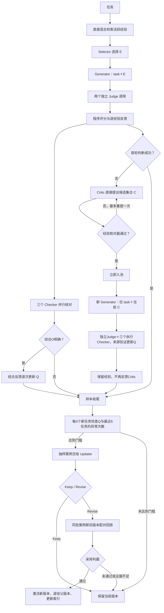
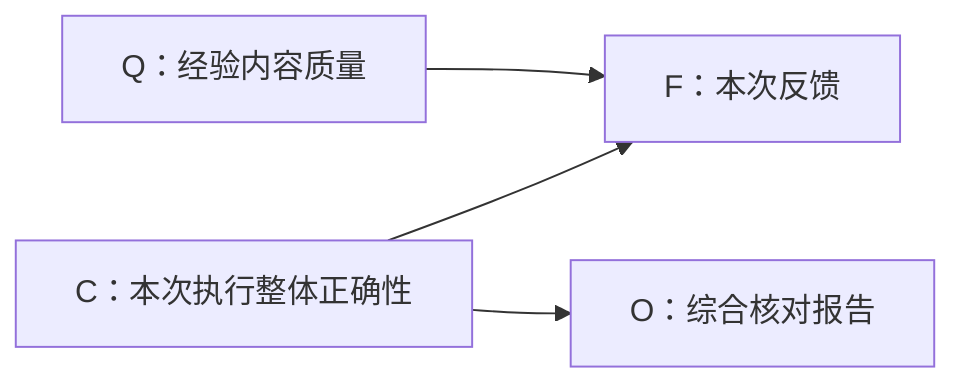

# VERGE 新方法设计方案 V2

Verified Experience-guided Rubric Generation

更新：2026-10-26。**状态：V2核心链路已实现并完成独立模块复测；已完成General30题在线采集预试验；尚无概率参数估计或冻结终测结果。**

本文是新版方法唯一的完整设计入口，整合用户提供的 V2 及后续确认。覆盖继续沿用的流程与新增机制，不再另设讨论稿或按模块拆分设计文件。代码已按[计划70](plans/70-V2核心链路与独立模块验证.md)实现核心链路；具体已实现范围与验证结果见工程文档和阶段计划，不能将实现完成解释为效果成立。最近一次旧方法完整实验为计划69。

旧总览与模块规范保存在[旧设计归档](历史设计/2026-10-24-V1/设计方案.md)。[工程设计](工程设计.md)记录当前V2接口与工程约束。[PLAN.md](../PLAN.md)记录进度。历史实验不能作为新版效果证据。

## 1. 目标与设计状态

VERGE 从偏好轨迹中提炼可复用的评分标准设计经验，通过后续应用改善其内容和适用范围。经验用于设计 rubric，不储存本题标准答案。

需要解决三件事：

- 经验经过选择、应用和 Judge 执行才得到反馈，反向结果不能直接认定经验错误。
- 内容质量、适用性与执行错误混在一个信用分数中，难以知道该修改哪里。
- 修改文本不等于修改有效，需要实际回放，并继续观察后续任务。

接受经验与评价存在噪声；不因为一次失败删除经验，也不假定累计足够次数就自动消除系统性偏差。

### 1.1 已确定方向

| 部分 | 新版决定 |
|---|---|
| 经验结构 | 仅trigger＋principle；每条为可独立应用的原子核验方法 |
| 原子化 | 删除 Atomizer；Critic 直接提案，Updater 直接 Keep／Revise |
| 类别 | 删除类别、归类器、描述更新器、分类队列与类别检索；直接检索活跃经验 |
| 标准引用 | 每条标准最多引用一条经验；允许不引用；一条经验可对应多条标准 |
| 首轮与候选 | 首轮 task＋E；候选新会话仅 task＋当前 C，不继续传 E |
| Judge | 同一套标准，分别独立评价两回答，不提供偏好标签 |
| 任务反馈 | 每个任务、每个经验版本汇总一次；F为正向／反向／净平局三状态；同判和正反抵消均为tie，满足更新门槛时参与Q更新 |
| 准入 | 经验核对器通过即入池，随后task＋C来源验证；有效F/O可更新Q |
| 长期信用 | 删除经验池中累计 P/N 及其继承／演化惩罚；保留原始反馈，长期质量使用 Q 后验 |
| 核对 | 有效错误报告优先：即使另有未知或调用失败，O仍为错误；三者全正确才为正确；无错误且有未知／缺失则跳过Q更新 |
| 概率模型 | 保留 Q/C 两因素贝叶斯网络，逐次更新；暂不建经验之间的依赖 |
| 参数来源 | 离线多模型、多次独立标注投票，估计实验版参数；新经验先验来自同样准入流程 |
| 修订与回放 | 归纳与回放共用最多6个不同任务，按3问题＋1来源＋1正向＋1适用性争议抽样，不足用近期案例补齐 |
| 演化范围 | 暂时取消Split；Keep保留当前版本，Revise仅产生一条候选新版本 |
| 替换规则 | 固定回放任务上，正向＋1、反向－1，其余有效无区分情形0；新版总分严格更高才替换 |
| Selector质量信息 | 读取Q、有效任务数及证据来源，适用性优先 |
| 边界案例 | 优先选历史适用性判断有争议的记录，不新增边界识别器 |

### 1.2 不能冒充已确定的细节

模型名称、每模型调用次数、投票阈值、标注规模、概率平滑强度等留到参数估计实验前讨论。修订节奏、异常次数和净区分替换规则已确定；Q阈值0.5、最低3个共同有效回放任务已确认为可配置的暂定默认值，不声称最优。第15节集中列出默认配置与延后实验事项。普通工程参数沿用现有设置；文中其他“接口建议”属于实施建议，不是已验证的最优方案。

## 2. 完整主流程

沿用 HelpSteer3 偏好任务加载、固定数据版本与任务去重。训练按固定顺序处理，留出评价冻结经验池与参数。



图中为逻辑依赖，不要求每次推断与业务纠错严格串行；样本收尾前完成必要事件提交。Checker 不篡改原 Judge 结果，贝叶斯网络不代替 rubric 加权评分。

### 2.1 数据可见性与角色

| 角色 | 读取 | 输出／权限 |
|---|---|---|
| Retriever | task、活跃经验索引 | 候选版本及检索排名 |
| Selector | task、候选完整经验 | 适用经验版本，沿用最多5条；不改正文 |
| Generator | task、当前允许的经验集合 | 标准、相对权重、单一来源和方法语义落实；不看两回答或偏好 |
| Judge | task、rubric、一份回答 | 每条 Boolean 与依据；不看另一个回答或偏好 |
| Calculator | rubric、两侧有效判断、程序持有的偏好对应 | 整体评分、四类逐项结果、逐经验反馈 |
| Experience Checker | 初始失败轨迹及候选 | approved及reason；明确缺陷才拒绝 |
| Critic | 本题真实失败轨迹与前轮反馈 | 每轮直接输出零条或一条原子经验；不直接入池 |
| 三个 Checker | 各自需要的任务／经验／标准／回答／实际判断 | 正确、错误、无法确定及简短证据；不见偏好标签或彼此结论 |
| Updater | 当前版本、抽样案例、实际反馈与核对证据 | Keep／Revise、目标字段及修改理由 |
| Replay Validator | 新旧版本、固定案例和配置 | 配对运行记录及净区分总分；新版严格更高才替换 |
| Bayesian Estimator | 有效 F、综合 O、参数版本、上次后验 | 新后验及可复算中间值，不生成文本 |
| Memory | 版本、应用、修订、标注和参数记录 | 一致保存、去重、追溯；不隐藏证据来源 |

Selector读取Q、有效任务数及证据来源（后续实际应用／修订案例回放分开），先判断Trigger是否适用，再参考质量信息。高Q不能抵消不适用，少量回放的高Q不能假装大量下游验证。未估计时明确标记，不伪造默认质量。字段明确命名为质量后验，不沿用旧confidence的含义；Generator继续不读私有质量统计。

## 3. 双字段原子经验

### 3.1 字段

| 字段 | 要求 | 含义 |
|---|---|---|
| trigger | 必填非空字符串 | 哪些任务适用及必要排除边界 |
| principle | 必填非空字符串 | 一个可独立应用的核验动作、判断依据及必要边界 |

虚构例子：

```json
{"trigger": "任务要求根据指定材料概括内容", "principle": "核对概括中的事实是否得到指定材料支持，不能混入其他材料的信息"}
```

删除经验template/parameters和标准bindings，不要求占位符、填参或渲染。Generator结合task将核验方法落实为具体标准；Generator Checker依据task、trigger、principle及引用标准判断语义忠实性、遗漏或任务外要求。原子性与泛化由Critic/Updater生成取舍和经验核对器检查，不因删除字段自动得到保证。程序只校验字段、非空文本、类型、引用ID和数量/权重等接口约束。

### 3.2 原子性与校验

原子性指一个能独立采用、评价和修订的方法，不按句号、字数或“并且”机械拆分。必要条件可以共同表达一个方法；相互独立的核验要求不应被拼接为一条。

删除独立原子化器，先验证结构变化与 Critic／Updater 直接输出是否有效。Updater只允许Keep或Revise，Revise保留一个核心方法，不能通过返回列表偷偷拆分。暂不提供自动拆分纠正原子性的方法，实际原子性效果仍需复测。程序只检查字段、非空文本、类型、有效ID、数量上限等可执行约束，不能宣称已检查语义原子性，不新增隐蔽的原子性审核调用。

提示词要求简洁，不通过硬截断或输出长度重试维持原子性。旧 content≤150字符、trigger≤60字符的提示词限制不能直接解释为双字段的完整长度契约；新版具体提示词限长待定。

## 4. 经验池、检索与选择

经验版本文本不可变；修改形成新版本，父版本退役后仍可审计。仅 active 版本参与正常检索。

删除 Category、CategoryOrganizer、CategoryDescriber、类别索引、成员映射、待归类队列以及类别展开。统一使用：

```text
任务 → 向量检索＋BM25 → RRF融合 → 活跃经验候选 → Selector → E
```

索引文本仅包含trigger与principle，不拼接历史案例、当前任务绑定或质量分数。沿用 Top20 候选、RRF k=60 和 Selector 最多5条作为工程初值，仍需局部验证。缺少关键词命中不凭任意排序贡献分数；向量失败不能静默切换实验条件。

索引与缓存绑定文本、嵌入模型和分词版本；Q 变化不重做文本嵌入。新版本生效后替换索引，退役版本不再参与选择。保留召回、未选择、选择但未引用等状态，它们不是负反馈。

## 5. Rubric、Judge 与反馈

### 5.1 评分协议

标准为正向、可判断的问题，包含非负相对权重；Generator根据task主次分配整套总权重1，程序归一化兜底，总有效权重须大于零。总和偏离1不额外调用模型纠错，合理等权允许，但不能机械逐条填1或强制制造差异。一条标准最多一个 source_experience_version_id，可为空；一条经验可对应多条标准。禁止多来源标准，暂不表达经验组合依赖。

Generator 不见 chosen/rejected；Judge 对两回答使用同一套 rubric，分两次独立调用，每项返回 Boolean 与原文依据。程序保存匿名回答与数据集偏好的对应关系。

整体得分为各条归一化权重乘满足值后求和。chosen 得分严格高于 rejected 才算整体判断成功；平局为未成功。格式错误、缺项或无效 Judge 返回须经过有限纠错，无有效结果不制造反向反馈。

### 5.2 四类原始结果与一次任务反馈

| chosen 满足 | rejected 满足 | 原始结果 |
|---|---|---|
| 是 | 否 | 正向区分 |
| 否 | 是 | 反向区分 |
| 是 | 是 | 双方满足 |
| 否 | 否 | 双方不满足 |

对任务 t 中版本 e 实际引用的标准，分别求正向权重和 W⁺、反向权重和 W⁻：

- W⁺ > W⁻：F=positive，正向反馈。
- W⁺ < W⁻：F=reverse，反向反馈。
- W⁺ = W⁻，且至少一条正权重的有效引用标准：F=tie，净平局反馈。包括全部正权重标准同判（W⁺=W⁻=0）以及正反权重恰好抵消（W⁺=W⁻>0），统一按第三状态参与Q更新，不再保留cancellation反馈分支。
- 没有任何标准引用该版本，或引用标准的权重全为0：unused，不赋予有效F、不更新Q。

无有效引用标准或仅有零权重标准，不构成tie证据。原始双方满足／双方不满足继续分别保存；三状态仅是贝叶斯输入层的汇总。权重按十进制字符串转换为精确有理数，归一化、W⁺/W⁻及相等判定均使用Fraction，不设会改变反馈方向的浮点容差。

W⁺／W⁻只是本次聚合中间量，不累积为经验池中的 P/N。所有原始权重、标准、引用和四类结果保留。派生展示分数的重载校验允许1e-12绝对误差，仅验证已存浮点结果，不参与F方向和准入判定。

每个任务、每个经验版本至多一次质量更新；先汇总该版本实际引用标准得到一个F，再结合一个综合O更新Q。明确不采用逐标准贝叶斯更新、逐标准加权似然或任务证据强度分摊；逐标准原始数据只用于汇总、核对与审计。不能将同一经验的多条标准当作独立任务重复更新。原始反馈强度会在三状态汇总时丢失，保留原始数据用于敏感性分析，不擅自增加 margin 或信用量放大项。

例：A 对应0.3正向与0.1反向，A获得一次正向；B对应0.2双方满足，B获得一次同判反馈。两者均在具备有效核对证据与参数时更新Q。整体是否成功不替代这些逐经验结果。同判并非固定负反馈，其对Q的影响由条件概率表和O共同决定。

### 5.3 多经验与样本隔离

每条经验只使用自己的标准结果及自己的 Checker 证据。不能将整题 O 或成败复制给所有经验。不同经验可在同一任务得到不同方向；它们共享任务，联合统计时不能声称这些是独立样本。

未被引用、无有效判断或仅零权重引用时不更新 Q，仍保留应用及可用检查报告。Checker 错误报告不会自动撤销或覆盖 F。

## 6. Critic、候选应用与准入

首轮task＋E失败后，Critic保留本题真实多轮消息，每轮提出0或1条候选，最多两轮。新增Experience Checker（经验核对器）读取初始task、两回答、原始rubric/Judge轨迹及当前候选，检查方法合理性、原子性、可复用性和不必要的题目特定内容；只对明确缺陷拒绝，不因适用范围较窄或措辞不完美拒绝。场景类别可以是必要适用边界，偶然的人名/数值/答案细节不可硬编码。输出approved布尔值与简短reason，不新增复杂分析字段。

Critic的analysis可保留本题证据，trigger/principle则直接表达适用条件与单一核验关系，不举例、不附括号场景清单，不携带原题专名、固定数值、原句、具体剧情或改名后的情节。抽象须保留可执行动作与必要任务边界，不能退化为“准确、完整”口号；经验内容允许有待实际验证的噪声，泛化写法达标不等于合理性已证明。系统提示使用独立编写的抽象方法示范，长轨迹之后附加同一条输出提醒，第二轮及有限格式纠错也保留；不增加字段、调用或生成后语义过滤。独立逐题复测见[报告87](实验分析/87-Critic逐轮泛化优化.md)。

当前按用户决定采用[计划89 R10中文短版](实验分析/89-Critic简短中文继续优化.md)，关闭思考；原创虚构教学例展示从具体案例到抽象方法的提炼，JSON示意使用中性字段说明。适用条件偏窄的残余问题继续保留审阅记录，不因此宣称经验内容已正确、中文效果优于英文或线上零泄露。其他角色及候选核对、应用和质量更新流程不变。

未通过时仅把经验核对器报告反馈给Critic，接续重提；不重新生成rubric，不把候选应用的Judge结果或Generator错误反馈给Critic。核对器调用/格式纠错耗尽则记录错误并停止当前样本的候选分支，不把技术失败当内容拒绝。无候选则结束；最多两轮都被拒绝则不入池。

通过后立即入池，记录来源任务和核对报告，不再要求实际引用、净正向或整体成功作为准入门槛。随后全新Generator会话仅task＋当前C，不传原E、旧标准或前轮候选；Judge两次独立评价。此后无论整体成功、反向、同判、未引用或应用失败，都不再让Critic重提，也不撤销已入池经验。正常样本最多新增一条，不保留旧的两轮应用择优/回退机制。

首次重跑属于source_validation（来源验证），实际引用后运行现有三个执行Checker，以F和综合O更新Q，门槛与下游相同；未引用、无有效评价、O不明确或参数不可用时跳过。来源验证只入账一次，重估必须保留该首次证据而不重复计算；来源记录不计为独立下游任务、不参与每3个下游任务检查计数。完整来源轨迹保留供归纳。入池后即使首次生成失败，来源task仍保留在经验来源信息中，轨迹保存错误。

Q基础先验须由“经验核对器通过”的新准入流程重新估计，参数metadata必须声明admission_protocol=experience_checker_v1，拒绝旧净正向准入表。没有参数时仍为未估计；collection模式仍不更新Q。本轮不假定核对器报告是真值，通过只代表值得试用。

## 7. 三个并行 Checker

三个执行Checker在入池后的来源验证、正常下游应用及修订回放中运行；准入前仅运行新增经验核对器。拿到各自所需轨迹后可并行执行，不互相参考结论，不以 chosen/rejected 当逐标准真值。每个输出包含正确／错误／无法确定、简短原文依据和问题类型，不请求完整思维链。

| Checker | 核对内容 | 主要线索 |
|---|---|---|
| Selector Checker | task 与 Trigger 是否匹配、是否冲突 | 适用范围可能过宽／过窄或选择失误 |
| Generator Checker | Principle的核验动作与必要边界是否忠实落实 | 方法表述歧义、必要动作遗漏或执行偏离 |
| Judge Checker | 每个被引用标准下两侧 Boolean／理由是否符合回答原文 | 标准可判定性或 Judge 执行问题 |

原始报告记为 O_A、O_U、O_J。原则清楚而 Generator 未遵循，不自动要求修改经验；Judge 误判也不自动证明 Principle 不合理。

对每个任务、每个版本，按有效错误报告优先汇总综合O：任一Checker成功返回并明确报告错误，即使其他Checker未知或调用失败，O也为错误；三个均成功且全部报告正确，O才为正确；没有错误且存在调用失败，则综合结果不可用；无调用失败但存在无法确定，则O为未知。相关多条标准任一有明确错误也进入综合错误，保留细项定位。该“任一错误”汇总可能受标准数影响，标注与估计参数必须使用同一规则，并检查标准数敏感性。

调用失败／缺失与主动报告“无法确定”严格区分。Checker失败沿用有限重试，耗尽后保存F及已返回报告，不新增后台补跑或追记。失败本身不算错误，但不撤销其他Checker已返回的有效错误报告：若有错误报告则O明确为错误，可以更新Q；若没有错误报告且存在失败，综合结果不可用，本次不更新。

| 三个Checker的返回情况 | 综合O | 本次Q更新（还需有效F及可用参数） |
|---|---|---|
| 全部成功，全部报告正确 | 正确 | 更新 |
| 至少一个有效错误报告，其余可正确／未知／调用失败 | 错误 | 更新 |
| 全部成功，没有错误但至少一个未知 | 未知 | 不更新 |
| 没有有效错误报告，且任一个调用重试耗尽仍失败 | 不可用／缺失 | 不更新 |

因此“错误、未知、正确”和“错误、调用失败、正确”均得到明确O=错误，可以更新；“正确、未知、正确”得到O=未知，不更新。O=错误不等于直接扣分，仍由F、O和概率表共同决定Q变化。

tie（纯同判或正反抵消）与正向、反向一样，仅在综合O明确时结合O更新Q；没有增加Checker角色或额外一轮调用。正反抵消统一为tie，和纯同判一样满足门槛时更新Q及参与修订检查计数。核对器只是额外的噪声证据，不保证准确归因。

## 8. 贝叶斯质量网络

### 8.1 节点及图结构

| 节点 | 含义 | 可见性 |
|---|---|---|
| Q_e | 当前版本的方法内容合理／有缺陷，指principle核验方法内容 | 隐状态，版本内固定 |
| C_e,t | 本次选择、应用、Judge 三环节是否全部正确 | 隐状态，每次应用变化 |
| F_e,t | positive正向／reverse反向／tie净平局 | 程序观测，来自有效引用标准的任务级聚合；包含纯同判及正反抵消 |
| O_e,t | 综合核对报告：正确／错误／未知 | 模型报告，不是真值；仅正确／错误进入本次更新，未知留档 |



箭头定义条件概率关系，不自动代表已识别的因果关系。真实执行状态影响报告出现的概率，因此 C→O；推断时看到 O 可以反过来改变对 C、Q 的判断，不需要添加 O→F。

网络只汇总考虑“内容缺陷”和“执行干扰”。它没有单独的 A/U/J 隐节点，因此不能声称直接算出哪一个模块的真实故障概率；字段诊断使用三个原始报告与 Updater。Q 也不是 Trigger 完整质量、全任务泛化概率或因果贡献占比。

### 8.2 分解与逐次更新

在具有有效三状态反馈的应用范围内，暂作以下分解。下式是概率模型；在线调用另设更新门槛：O为正确或错误。O未知或没有错误报告且存在调用缺失时不执行推断，保持原Q；部分调用失败但已有有效错误报告可用O=错误推断。

```math
P(Q,C,F,O)=P(Q)P(C)P(F\mid Q,C)P(O\mid C)
```

参数固定后，对本次证据 D=(F,O)，从三状态概率表取出本次F对应的概率，再分别计算经验合理和有缺陷时的证据可能性：

```math
L_q(D)=\sum_{c\in\{0,1\}}P(C=c)P(F\mid Q=q,C=c)P(O\mid C=c)
```

令 π_old 为当前版本上一次后验，则：

```math
\pi_{new}=\frac{\pi_{old}L_1(D)}{\pi_{old}L_1(D)+(1-\pi_{old})L_0(D)}
```

即“合理状态的先验×证据可能性”，除以两种质量状态对应量的总和。新后验作为下一次先验。正向、反向、净平局使用同一公式，但仅在综合O明确时执行；O未知、综合结果不可用或缺少有效证据均不执行更新，不能反复用同一回放提高Q。

同判不预设升分或扣分。例如在相同执行条件下，有缺陷经验更容易同判，则同判可能降低Q；若两种质量状态同样容易产生本次证据，则Q不变。实际仍需对C求和，并考虑Checker噪声。经验合理且执行正确也可能同判，不能将其强制归为任一环节出错。

计算采用稳定数值方式，保存参数版本、前后概率和似然；参数内容、版本或可用状态变更后从指定基础先验及去重证据重算，不能把旧参数后验当新参数先验再重放全部历史。

### 8.3 需要估计的参数

| 参数 | 定义 |
|---|---|
| π0 | 经相同准入流程的新经验内容合理的初始概率 |
| πC | 模型使用的应用范围内，三执行环节全部正确的概率 |
| θ_qc,f | 四种Q/C组合下，正向、反向、净平局的三个概率；每组总和1 |
| h_c,o | C为正确／错误时O的报告概率；未知记录保留用于覆盖和误差统计，但在线不取未知项更新Q |

反馈表结构为：

| Q | C | 正向概率 | 反向概率 | 净平局概率 |
|---|---|---|---|---|
| 合理 | 全部正确 | θ_11,positive | θ_11,reverse | θ_11,tie |
| 合理 | 存在错误 | θ_10,positive | θ_10,reverse | θ_10,tie |
| 有缺陷 | 全部正确 | θ_01,positive | θ_01,reverse | θ_01,tie |
| 有缺陷 | 存在错误 | θ_00,positive | θ_00,reverse | θ_00,tie |

每行三个概率加起来为1，所以每行只有两个独立参数。反馈表由原二状态的4个独立参数增为8个；两个初始概率和核对器误差表的结构不变，网络节点、角色及每次应用的调用轮数不增加。参数数目增加不代表已有足够数据，须检查四组各自覆盖。

一个实验参数版本先供所有经验共享，各经验维护独立 Q 后验。Q/C 在先验上独立、F/O 给定相应隐状态后的独立性、跨任务条件独立均是近似；经验歧义可能影响执行，Checker 也可能与 Judge 同错。这些假设必须作为敏感性项目，不能被图结构掩盖。

有效tie（纯同判或正反抵消）与正向、反向都可进入质量更新，但在线还要求综合O明确。部分调用失败且已有有效错误报告的记录进入O=错误组，缺失模式须单独保留，并在参数实验中使用同一汇总规则。参数实验必须记录这一筛选条件，未知及失败记录单独保存，不硬转为错误。若仅用O明确子集估计更新参数，须统一处理πC、反馈表、报告误差表及先验适用范围，不能只删除h的未知列并归一化、其余参数照旧。是否保留完整三态报告模型作统计或使用一致的条件模型，待参数实验时固定；两者都不对O未知的在线记录更新Q。筛选可能改变Q/C依赖，需报告。

## 9. 参数获取：离线多模型投票

### 9.1 独立参数实验与统一标注标准

**讨论时机：**参数估计实验的模型名单、每模型调用次数、投票门槛、采样量及稀疏概率处理，等准备开展该独立实验时再讨论，不作为当前继续明确主流程或实现基础模块的前置讨论任务。离线标注与参数估计尚未启动；General30题采集预试验见报告73，在线推断仍需实际可用参数。

单独开展一组隔离的新版应用实验，使用新经验结构、引用协议和三个Checker，采集正向／反向／净平局及核对报告，再做多模型标注并统计参数。旧日志没有这些完整信息，不能直接当作新版概率表。采集阶段不依赖尚未建立的Q选择经验或自动修订，不写生产经验池；保存准入来源和任务分布。在线采集已完成General30题预试验；离线标注与参数统计尚未启动，模型名单与调用预算待采集检查后讨论。

所有标注模型采用同一Q说明：在满足Trigger的前提下，检查Principle的方法是否合理、核验动作和必要边界是否明确。方法有实质歧义属于内容缺陷线索；明确指令被执行模型违反，不算经验内容缺陷。无法判定时标未知，不以正反反馈代替内容核验。Trigger范围问题另由适用性证据处理。

### 9.2 采样与标注

1. 从独立实验采集的新版应用记录按任务去重抽样，覆盖正向、反向、同判、时间段与任务类型，并单独收集刚通过准入的新经验。旧日志可帮助选题，但需按新版协议重新获得实际应用和Checker证据。
2. 多个标注模型各自多次独立调用，不读取其他投票或在线 Checker 结论；尽量与在线执行模型区分。具体模型、调用次数及预算待定。
3. 分别标注方法内容 Q，以及本次适用 A、忠实应用 U、Judge 正确 J；可回答无法确定并给短证据。Q 不得仅用本题正反方向判定；同一版本的 Q 标注不因案例多而重复计算先验。
4. 不提供偏好标签或最终正反反馈作为标注提示；判断 J 需要看到实际 Boolean、理由和回答，这不等于可以看到其他 Checker 的答案。
5. 汇总后将 A/U/J 合成 C，与在线 O 及程序 F 对照估计参数。C 标签有任一明确错误可判为错误；无错误但有未知则无法确定。

已确认使用多模型多次投票。**建议汇总方式：**先模型内汇总，再模型间等权，避免调用多的模型主导；分歧大保留未知。具体门槛、平票和未知规则需在运行前固定。

### 9.3 统计规则

- π0 按同一准入流程产生的新经验版本统计，不从幸存活跃池估计。修订版本先共用基础先验是简化假设，出生路径差异单独分析。
- 四种Q/C组合分别统计正向、反向、同判的比例；每组以三类有效记录的总数为分母。h表统计同一应用范围内在线报告与投票参考标签的一致／错误／未知情况。同判需要实际核对证据，不以“未区分”直接标Q或C为错误。综合O未知／不可用的记录标明不用于在线Q更新；部分调用失败但O明确为错误的记录可更新，需保留缺失标志；参数估计的明确O子集与全体报告统计分别记录，不能混用分母。
- 对应状态无法确定的记录不能硬填标签；保留未知比例、争议和覆盖分布，不能只报容易达成共识的一部分精度。
- 若为覆盖问题而过采样失败案例，估计基础频率须采用代表性样本或明确采样权重，不能直接拿平衡样本比例当自然先验。
- 保存各格有效样本数、分布、平滑方法及不确定性；稀疏或空格不假装已有可靠概率。阈值、平滑及最低量待定。

投票得到的是**实验性参考标签**。多次同模型输出不等于多个独立专家，模型一致也可能共同犯错。得到的是相对于参考标签的参数估计，不是经人工真值验证的真实错误率。可以先不做大规模人工标注，但必须标记为自动标注参数，不宣称实现可靠校准。

参数有效性比较及其验证安排暂缓讨论，待后续实验阶段再决定。参数不足时保留原始证据及“未估计”状态，不伪造概率或静默恢复旧 P/N。参数能否用于在线自动决策的验收条件仍待确定。

## 10. 修订触发与 Updater

### 10.1 检查节奏与双入口

每个活跃版本累计3个新的、不同下游任务的有效三状态反馈后，由程序检查一次门槛，不新增检查LLM调用。正向、反向、tie（包括同判与正反抵消）都计数；重复任务、来源验证、历史回放、无效结果及unused不占这3个名额。Q仅在F有效、综合O明确且参数可用时更新。F有效但O未知或Checker失败的任务仍可计入3个任务的检查节奏；失败／未知不当错误，已有成功报告可保留诊断。触发计数不能与Q更新次数混淆。

程序检查两个条件，任一满足才调用Updater：

- 内容风险：当前可用Q低于0.5（已确认的可配置暂定默认值，不是已验证的最优阈值）；Q未估计或仅有初始先验时不触发此入口；本轮新增任务中须至少有一次本版本实际Q更新，不能仅凭旧风险加新未知报告反复调用。
- 执行异常：最近最多6个不同下游有效反馈任务中，任一环节被其Checker至少3次报告错误。3次为用户确认的默认阈值；各环节独立累计，同一任务同一环节最多计1次，不因多条标准放大，也不将不同环节的零散错误凑成3次。

错误类型可以不同，例如两次绑错参数、一次遗漏方法都属于Generator环节的3次报告。未知和调用缺失不算错误，记录其覆盖数；异常是模型报告，不是真实故障确认。这里使用每环节直接错误计数，不再用条件异常率另设第二套触发门槛。

检查结束后，无论未达门槛、Keep、修改未采用，都等待新的3个任务再检查；相同错误证据不反复触发：按环节保存已消费的task_id；只有尚未消费的错误报告参与3次门槛。未达到门槛的错误仍可在最近6题中跨检查批次积累。历史案例仍可作为归纳背景。可恢复调用只在本次有限重试预算内处理，耗尽后记录失败，不立即开启新的业务检查。最近6任务是异常统计窗口，不是强制的Updater输入集或回放预算。

多个环节同时达标，只发起一次Updater调用，提供各环节证据及命中原因；不分别修改多遍。门槛只决定检查，Updater不必修订。具体输入字节预算实施时固化；Checker耗尽失败不安排后台补齐。

### 10.2 字段诊断与操作

| 达到门槛的线索 | Updater优先检查 | 不能直接得出的结论 |
|---|---|---|
| Selector Checker反复报告不适用 | Trigger的范围、必要条件和排除条件 | 也可能只是Selector没遵循清楚条件 |
| Generator Checker反复报告偏离 | principle的清晰度、可执行性及必要边界 | 也可能只是Generator执行错误 |
| Judge Checker反复报告误判 | principle产生标准的歧义与可判定性 | 不为迎合Judge错误而强改合理方法 |
| Q内容风险达门槛 | principle及具体反证 | 不是低Q就必须改写 |

Updater只返回Keep或Revise。Keep保留当前版本；Revise必须输出一条完整候选版本，说明目标字段和简短修改理由。暂时取消Split及所有子经验分配、整组回放与部分激活机制。Critic仍可在一轮提出多条独立经验，这与Updater一次修订一条经验不同。

修订应围绕当前核心方法，不不断追加独立要求，也不把多条经验塞入列表。无关新方法由正常Critic流程提出。没有可复现的经验缺陷时Keep，明确要求被模型违反时也可以Keep。程序只验证结构，不增加语义原子性审核角色。

Keep不创建新版本；Revise未通过回放不覆盖父版本。格式纠错预算和Critic候选数量上限仍需配置，禁止在相同证据上无限重试。

## 11. 同批案例归纳与配对回放

### 11.1 案例集

归纳与回放使用同一个案例集S，默认最多6个不同任务，按“3＋1＋1＋1”选择：

| 名额 | 案例来源 | 选择顺序 |
|---|---|---|
| 3个问题案例 | 引发本次检查的Checker错误报告，或近期使Q下降的案例（包括同判） | 多环节触发时优先覆盖不同环节，再按由近到远选择；仅报告未知本身不算错误 |
| 1个来源案例 | 最初提出并通过经验核对的任务 | 修订版本可沿血缘追溯；不把来源反馈重复更新Q |
| 1个历史正向案例 | 已有正确区分的实际应用 | 用于检查修订是否破坏已知正确用法 |
| 1个适用性争议案例 | Selector选中，但Selector Checker报告不适用或无法确定 | 没有争议案例则选近期任务 |

适用性争议只是判断不一致或不确定，不代表Selector或Checker一定错误。它用于检查Trigger范围与表达，不新增边界识别器。

按表中顺序选择并按task_id去重；同一任务可能同时是问题、正向、来源或争议案例，只占一个名额。多轮／不同版本的关联记录可以保留，并明确实际版本与轮次，不能拆成多个独立任务名额。某类不足或重复，空缺从尚未选择的近期案例补齐；整个历史不足6个则使用实际数量，不重复凑数。每次记录抽样种子（若使用随机采样）、顺序、来源版本及名额用途。

Q风险触发时，确实导致后验下降的同判记录可以进入3个问题名额，避免Updater看不到触发证据。O未知或综合结果不可用的记录没有产生本次Q下降，不能伪称为降低Q的案例；部分Checker失败但O明确为错误并实际降低Q的记录仍可入选，但可按争议或其他已知诊断条件入选。来源、祖先及回放记录可用于上下文，不自动算作当前版本新增下游反馈。

同一个S先交给Updater，再用于新旧版本回放，不另留独立验收集。样本重用是已确认的简化安排；结果解释为历史问题修复，不是独立泛化证据。

### 11.2 公平比较

固定 task、回答对、模型／提示词版本、思考设置、参数、评分协议与其他经验背景。旧臂用父版本，新臂只用一条修订版本替换父版本。回放先在隔离快照进行，不写原活跃池。

Trigger 修改必须经过正常检索与 Selector，不只强制交给 Generator。两臂共享同一背景池，各自以目标候选替换父版本，并重建相应索引。未召回、被拒选、选中未引用、同判、正向、反向都记录。简化分数可能因少选而减少反向、从而提升；接受该限制作为首版取舍，但不得将这种提升宣称为内容缺陷已修复。纯内容修订是否允许固定候选的诊断回放待确定；其结果不得外推为检索改善。

父版本历史结果在task、回答对、模型与提示词版本、生成配置、其他经验背景、检索/选择及应用方式可核对一致时可以复用；否则在固定比较条件下重跑父版本。此处为避免条件混淆的执行约束，不意味着所有父版本必须重跑。缓存复用记录完整指纹和来源；回放错误记录为缺失或无效，不计为另一臂获胜。

### 11.3 净区分表现决定替换

已确认采用简单的程序指标，不直接比较新旧Q，不增加验收LLM。对每个回放任务，仅汇总被比较版本引用标准的结果：

| 本版本结果 | 回放比较分数 |
|---|---:|
| 净正向 | ＋1 |
| 净反向 | －1 |
| 同判、正反抵消、正常未召回／未选择／未引用、仅零权重引用 | 0 |
| 技术失败或无效评价 | 缺失，不记0分 |

先取新旧两边都有有效结果的相同任务集合，再各自求和。新版总分严格高于旧版才替换，等于或低于则保留旧版；共同有效集合为空不替换。其他背景经验的标准参与正常rubric评分，但不纳入本次目标版本的回放比较分数。

技术失败不能让另一臂自动获胜，保留计划样本量、共同有效数与排除原因。回放使用已确定的最多6个案例，至少3个共同有效任务才作替换决定；3为已确认的可配置暂定默认值，不足时保留旧版。正常未选中新经验仍算有效回放，得分为0，但不更新其Q；有效回放数量不等于实际应用验证数量。Checker错误和逐案退化仍留作诊断，但不另叠加“旧版每条正向都必须保持”或“目标异常必须减少”等采用门槛。

该总分是单次回放验收指标，不是长期P/N，不参与贝叶斯似然计算。tie（含同判和正反抵消）在比较中记0，但仍结合O更新新版本Q。每个任务仍对目标版本贡献一次比较分数，不能按标准条数重复加分。

明确接受首版取舍：部分任务退化可能被其他改善抵消；收窄Trigger造成不再引用也可能把反向－1变成0。这不证明内容已修好或未来更好，后续任务继续验证。抽样和结果全量留存，不能挑选有利子集后重算采用结论。

### 11.4 单条新版本的质量重建

候选新版本从基础先验开始，用自身有效回放 F/O 逐次建立暂定 Q，不复制父Q、不继承旧P/N或λ惩罚。同批案例参加修订和测试被允许，须标为“修订案例回放后的估计”，可能乐观，不能当成独立泛化验证。

父版本回放只用于配对比较，不再次改写父版原有后验。新版本同一任务一次入账；后续再次出现同一 task 时保留运行记录但不重复作为新独立证据。进入 active 后正常新任务继续更新。祖先案例只作上下文，不自动变成修订版本已验证记录。

## 12. 贯穿示例

虚构任务：材料1说北京周一举办讲座，材料2说上海周三举办展览；要求概括材料2。回答a为上海周三展览，回答b为北京周一讲座，数据集偏好a。

1. 检索选择“核验事实依据”，Generator把核验标准的材料对象误写成材料1。
2. 两次独立 Judge 按实际标准判断a不满足、b满足，程序记录反向。
3. Selector Checker 可能报告适用；Generator Checker 可能报告核验对象选错；Judge Checker 可能报告 Judge 忠实执行了当前错误对象标准。综合 O 为错误。
4. 贝叶斯程序用实验版概率表计算新 Q；反向是否明显降低 Q 取决于参数，不保证“核对器说用错就不扣”。
5. 历史上重复发生此类异常时，Updater检查核验对象的表述。若来源已经清楚，只是 Generator 失误，可 Keep；若定义歧义，可 Revise。
6. 用同批案例比较旧版与新版标准的实际核验对象、评价、覆盖及退化。通过明确验收规则后才激活新版，Q 从它自己的回放建立。

例子只解释流程，不假造具体先验、误差率或证明方法已有效。

## 13. 记录、恢复与展示

### 13.1 最小数据对象

| 对象 | 必要字段 |
|---|---|
| ExperienceReview | approved布尔值与简短reason，不作为真实有效性认证 |
| ExperienceVersion | 来源sample、经验核对报告、稳定版本ID、父版本、trigger/principle、候选/活跃/退役状态、来源任务、q_prior/q_posterior/参数版本、应用/修订记录引用 |
| ApplicationRecord | task与实际版本、阶段、选中/引用状态、标准/权重/引用来源、两侧原始判断、四类结果、W⁺/W⁻、三状态F或unused/无有效证据原因、三个报告及细项、综合O、更新前后Q、是否入账及原因 |
| RevisionRecord | 父与候选版本、触发原因、目标字段、抽样案例及实际来源版本、Keep/Revise、两臂完整回放、决策及依据 |
| ProbabilityModel | 参数与估计方法、模型/提示词/聚合/筛选协议版本、标注数据来源、计数/未知/覆盖、实验或可用状态 |
| AnnotationRecord | 独立调用结果、模型内外票数、分歧与未知、参考标签、未提供信息说明 |

不包含长期累计 alpha/beta/P/N、继承惩罚、category_id 或分类队列。需旧 P/N 基线时按原协议从原始日志离线重算，不能把新版三状态结果冒充旧权重证据。

证据来源至少区分正常训练、候选准入、历史回放、独立评价；保存请求/回复、短编号映射、模型配置、费用与错误。给LLM用短数字 ID，存储保留稳定真实 ID。

### 13.2 故障与一致性

保留有限格式纠错、可恢复请求有限重试、单样本错误隔离。某个案例耗尽重试后记录失败并继续后续任务；鉴权、全局配置、数据/存储和程序错误仍 fail-fast。缺失结果不变负反馈。

更新器或回放失败保留父版本和既有有效证据。通过验收后，父退役、唯一修订版激活、血缘与索引变更作为一致提交；回放不提前污染正常检索池。参数更新须支持可重复重算，事件去重规则跨重启保持一致。

协议、Memory、Trajectory、Manifest 与提示词版本统一升级，不跨旧方法 resume，不为旧格式添加生产兼容；旧日志继续按旧协议解释。本次写文档不删除运行日志、数据或缓存。

### 13.3 冻结与 WebUI

held-out冻结经验文本、状态、应用计数、Q、概率参数、修订与标注采样；正常评价只做检索/选择/R0/Judge。可将研究所需报告另存为不反馈训练的评价产物。参数估计、提示词调整与采用规则不能读取终测标签后回写。

WebUI 展示统一活跃/退役经验列表、适用条件与核验方法、Q及估计来源/证据量、四类反馈、逐任务报告、演化与配对回放；删除类别页与分类筛选，保留排序、搜索和点击后滚动位置。未估计Q显示未估计，基础先验显示证据不足。继承历史与本版本实测分开；公开说明回放并非独立验证。

源码维持扁平结构，密钥不进日志，仅监听127.0.0.1。Web启动与翻译按项目约定和实际权限执行；文档修改不启动服务。

## 14. 分阶段落地与验证

| 阶段 | 交付 | 验证重点 |
|---|---|---|
| 一 | 双字段经验、单一来源标准、直接检索、移除类别与Atomizer | 字段契约、语义原子性、方法保留、正常案例退化 |
| 二 | 三个Checker、逐任务反馈、原始证据账本 | 信息隔离、聚合、未知/失败、误报与成本 |
| 三 | Updater Keep/Revise、隔离配对回放、版本生命周期 | 不污染父池、单版本替换、去重、净区分验收 |
| 四 | 独立新版应用采集、多模型自动标注、参数估计、逐次推断 | 数据覆盖、参考标签分歧、稀疏参数、数值与重算、敏感性 |
| 五 | 受控消融与独立泛化评价 | 贝叶斯增益、首轮准确率、修订退化、调用和时间成本 |

阶段三可先验证规则触发和回放模块，Q 未准备好时标为不可用，不临时恢复旧信用体系假装完整新版。本次授权实现与独立模块复测；真实完整训练与参数估计实验不自动启动。

按 AGENTS 约定，每个被修改模块至少20条按任务去重的代表性真实历史输入，独立复测、隔离产物，不直接重跑整条链。模型基准Qwen3.5-Flash，显式记录思考设置；离线多模型投票名单另定。模块20条复测不等于概率表每格已经足够，也不等于每次运行时回放必须20条。

当前讨论暂不展开“多模型投票概率表是否更有效”和“修订后能否改善后续任务”的验证设计，不将回答这两项效果问题作为当前流程定稿的前置条件；尚未得到效果结论，相关实验仅保留为后续方向。

对照保留：自由文本／半结构化／可选模板；原Atomizer／Critic直接提案；旧P/N／Checker＋规则／Checker＋贝叶斯；有无修订回放。原子性、忠实应用、任务正确率和成本分开报告。没有控制对照不能将收益归因于网络，记账正确也不等于经验质量已得到区分。

## 15. 默认配置与延后实验

| 项目 | 已确定的规则与默认值 | 实施配置或延后实验事项 |
|---|---|---|
| 自动标注 | 多模型、多次、独立投票、允许未知 | 开展参数估计实验前再讨论模型、预算、模型内外票数及门槛、争议处理 |
| 先验与概率表 | 新经验使用经验核对通过群体的先验；首次来源验证有效时更新Q一次 | 数据规模、最低量、平滑、明确O筛选条件下的一致估计与版本重估时机，待参数实验前讨论 |
| 在线质量 | 长期只维护Q；Selector读取Q、任务数与证据来源，适用性优先 | 参数何时足以控制行动；提示词中的质量信息呈现 |
| 反馈与检查 | 错误报告优先，部分调用失败不阻止明确错误的O更新；O未知／不可用不更新；准入不运行Checker，无后台补跑 | 十进制Fraction精确汇总；有限重试，细项采用criterion_id/status/evidence且与总状态一致 |
| 修订时机 | 每3个新有效F任务程序检查，tie（含同判和正反抵消）计数；最近6任务同环节3次错误触发；Q阈值0.5为可配置暂定默认值 | Q阈值效果留待后续实验；有限错误重试预算沿用现有设置 |
| 归纳/回放案例 | 同批最多6任务，3问题＋1来源＋1正向＋1争议；去重，不足用近期案例补齐；触发风险的同判可占问题名额 | 无新增抽样类别；字节预算按工程配置确定 |
| 采用 | 至少3个共同有效任务，且新版净区分总分严格更高才替换；技术失败不算0分 | 最低共同有效任务数3为可配置暂定默认值；已接受逐案退化可能被其他改善抵消 |
| 输出 | Critic原子集合、Updater Keep/Revise | Critic候选数量上限、提示词长度与纠错预算 |

核心流程可按本文开始实现，无需等待延后实验的效果结论。参数实验细节在开展该实验前讨论，不用虚构概率表控制在线行为；普通工程参数沿用现有设置，其余接口细节按本文规则落实。暂定默认值的确认不代表效果已经验证。后续直接修订本文，不再创建并行讨论稿或模块方案。


## 16. 审查修复后的工程契约

- 任务身份为task按空白归一化后计算的SHA256；sample_id标识一次数据记录，不代表独立任务。数据加载拒绝split内重复任务；train/test重叠、入账、重估、检查节奏和案例抽样均使用同一身份。首次来源验证可更新Q一次；该来源任务后续重复应用不再次入账，来源不计独立下游验证。
- 每套Rubric输出2至8条标准，允许空来源和零权重，整套权重须有正值；这是当前明确的接口预算。零权重引用也可运行Checker，保留报告，但不产生质量证据。
- 应用账本保存召回/选中/引用状态、检索排名及轨迹、轮次、无证据原因；回放未召回、被拒选、选中未引用与同判分开。归纳案例记录sample_id/task_id/实际version_id/phase/round/kind并投影给Updater；Updater直接读取程序汇总O、四类结果、权重和入账原因，不自行猜测是否计入Q。
- Generator/Judge Checker的细项为criterion_id/status/evidence；任一细项error不能同时总报correct，未知细项也不能总报correct。矛盾输出走有限纠错，耗尽记failed；综合O仍遵守有效错误优先。Selector Checker仅核对单条Trigger对task的适用性，不负责多经验依赖。
- 参数按完整规范化内容计算摘要，包含状态与元数据。参数metadata必须声明feedback_protocol=net_direction_tie_v1；概率表的tie列同时覆盖纯同判及正反抵消，旧口径表不能直接复用。同名修改也必须显式重算。`reestimate`在新目录复制认证产物，从先验和去重账本重建，不改原运行；保存参数事件、快照和新哈希。历史Trajectory/修订事件中的Q保持当时值，当前Memory是重估结果；原评价的参数来源另存，不把重估称为重新评价。
- CLI仅有训练数据时明确标记training_only，训练结束状态training_completed。配置了非空test时，训练完成后执行冻结评价才标记completed；stop_after_train小于训练量才paused，达到训练量不会跳过已配置test。不下载或查看新held-out是当前任务边界，不代表放弃后续冻结评价。
- Web显示基础先验/证据不足、来源/下游/回放数量、四类原始结果、检索/选择、逐任务Checker和原始请求入口；回放不是独立泛化验证。回放角色日志关联实际回放任务，保留所用版本。

本轮反馈简化见[计划72](plans/72-统一净平局反馈.md)；三个Checker继续按每条实际引用的经验独立检查，不合并不同经验的报告。

### General在线采集预试验

按[计划73](plans/73-General在线采集30题.md)先测试30道General训练任务，保留单轮/强偏好/标注一致筛选；按偏好强度与任务长度分层按比例抽样。`run.mode=collection`禁止概率参数、自动修订和held-out访问，Selector只接收任务与经验双字段、不接收Q或使用次数。候选准入与逐经验Checker保持现有流程。先检查完整轨迹和Checker，再讨论提示词及正式采集；不自动扩大到200题或启动离线多模型标注。

历史计划75/79/81中的模板与参数设计已由计划84移除；当前经验仅trigger和principle。

Generator权重示例按[计划76](plans/76-Generator权重预算提示词.md)展示多条共享预算，不规定固定条数或权重配方；程序继续保留原始weight及normalized_weights，归一化不替代模型的重要性判断。

当前经验不再包含模板、参数，标准不包含bindings或binding_evidence。调用记录同时保存模型返回和程序校验结果，Web列表直接显示请求失败、结构校验失败及具体错误，见计划81。

经验核对准入及来源验证按[计划82](plans/82-经验核对准入与来源验证.md)实现，来源反馈与下游证据分开；本次独立复测的格式通过不代表核对器可靠，详见报告82。

计划84的当前实现仅保留trigger/principle与标准引用，不再执行模板生成、参数定义、绑定或渲染。完整历史运行只读展示，旧协议不续跑。

## 批次并行训练与假设参数实验（2026-10-27）

用户授权中期预实验使用人工假设概率表，明确未估计、未校准；仅用于探索完整链路，不证明概率可靠或贝叶斯机制有效。参数metadata记录来源及假设标识，运行保存完整概率表和摘要。正常参数估计方案保留。

训练支持`run.train_workers`（默认1，正整数）。大于1时按固定顺序划分批次，每题独立使用批前经验池、Q与版本状态快照；批内不互通新经验和反馈。本题核对准入的新经验仍可立即供本题来源验证使用。整批完成后按原样本顺序合并准入及应用证据，在共享账本重新逐次计算Q，避免并行覆盖；只在批末串行检查并执行修订，再开始下一批。轨迹中的Q前后值以合并后的账本为准，生成时看到的Q以实际调用日志为准。
