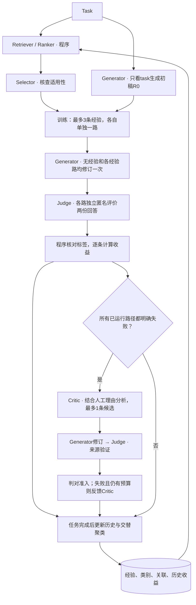

# VERGE v3.1设计方案

2026-11-13。本文将已确认讨论整理为v3.1目标设计，**尚未实现或实测，当前代码仍为v3**。旧设计与工程约束见[v3归档](历史设计/2026-11-13-v3/README.md)，实验依据见[500题报告120](实验分析/120-General500题四路流程实测.md)和[内容审查122](实验分析/122-改善与退化114题内容分析.md)。

## 1. 目标与设计取舍

VERGE从偏好轨迹提炼评分标准设计经验，通过后续任务验证，学习经验对不同任务的作用。基础模型参数不变，训练更新经验文本、提供关系、类别及历史收益。

v3在391个有效有／无经验配对中52改善、62退化，未显示净收益；类别稀疏、来源过拟合风险、标准被经验改写、组合干扰和Judge错误均有证据，但各自损失贡献尚未隔离。v3.1采用以下取舍：

| 问题 | v3.1设计 |
|---|---|
| 具体对象关联稀疏，两侧分组未互相提供信息 | 比较归一化的对侧类别关联分布，与文本融合，交替更新两侧分组 |
| 经验下游验证不足 | 同题最多试用3条经验，每条单独一路，平等积累轨迹 |
| 组合效果有记录但没有学成选择策略 | 本版不使用组合，不做组合信用分摊 |
| 经验可能改写任务要求 | 先生成任务初稿，各路再同等修订一次 |
| Critic可能追逐来源题输赢 | 使用人工偏好理由，先核对失败依据，依据不足可不提案 |
| 已有成功路径仍继续产生经验 | 只有所有路径明确失败才触发Critic |
| Judge误判污染反馈 | Critic分析执行问题，纯Judge问题不提经验；误判本身仍未解决 |

## 2. 总体流程

训练与推理采用相同主干：**程序召回排序 → Selector选择 → 生成任务初稿 → 根据该路输入修订 → Judge评判**。训练增加无经验对照、独立经验试用、Critic和历史更新；推理读取冻结历史，只执行所选一路。



图中Critic即时验证如何复用初稿属于待明确的执行细节，见第7节；不是已实现行为。

## 3. 经验选择与生成评判

### 3.1 程序召回，Selector最终选择

新任务用嵌入向量匹配多个历史任务组。程序先汇总经验在相关组中的收益，再按任务与组相似度加权：

```text
u(g,E) = E在组g的有效信用总和 / 不同有效任务数
score(t,E) = Σ_g similarity(t,g) × u(g,E) / Σ_g similarity(t,g)
```

只累加E有直接效果证据且相似度大于0的组；无证据不视为0，不进入分母。组内先求均值，不额外按组样本量加权；保存证据量供参考。

候选最多10条：先取6条历史收益候选，再补不重复的全池语义候选；历史不足或去重缺额由语义补齐，无达标任务组时全部走语义。保留全池入口，避免选择被既有关联锁死。经验类别不直接限制候选或替代单条收益。

Selector根据task和经验前提最终选择，训练最多3条、推理最多1条，可以少选或不选；不强迫凑数，不划分首选／探索经验。历史收益只作参考，不设“必须大于0”的使用门槛，也不由程序替代Selector作最终决定。

### 3.2 共享初稿，同等修订

Generator只看task生成R0，再由各路读取task、同一R0及本路经验，修订一次。所有修订使用相同指令和设置；无经验路的经验输入为空，也修订一次。

| 路径 | 输入经验 | 用途 |
|---|---|---|
| 无经验 | 空 | 修订后作为对照 |
| E1 | 仅E1 | 独立验证E1 |
| E2 | 仅E2 | 独立验证E2 |
| E3 | 仅E3 | 独立验证E3 |

选k条就运行k＋1路，最多四路，不运行任意经验组合。经验不适用时允许保留初稿内容；初稿有错可纠正。修订不得把经验变成任务事实、固定写法或额外义务，仍需保护对象、数量、范围及任务允许的选择。

Judge根据task、该路Rubric和当前匿名回答逐项判断，两份回答独立评价；程序按标准权重汇总。chosen得分严格高于rejected才记判对，平局记未判对，技术失败未知。Generator不声明经验引用，程序记录实际提供的经验ID。

Selector和Generator不看候选回答、标签或人工偏好理由；Judge不看另一回答、偏好标签、经验或Critic诊断。推理同样先生成初稿、再修订一次，即使未选经验也不跳过修订；不运行对照、Critic或历史更新。

## 4. 训练反馈与经验生成

### 4.1 逐条信用与关联

```text
c(E_i) = r(E_i) − r(∅)
r = 1（判对）或0（未判对）
```

每条经验与本题无经验路独立配对，信用可为−1、0、1。任一对应路径技术未知则该条信用未知，其他有效配对不受影响；不使用Judge原始评分差。共享基线并不使三条轨迹成为三个独立任务，每题每经验只记一份证据。

三条平等试用，不指定事前实际路径，也不事后挑最好一路作为推理结果。“至少一路成功”仅表示试用覆盖，不能当成推理单路准确率。

关联定义为后续独立任务实际向Generator提供过的入池经验。三条分别试用均建边，同题去重；未被选择的检索候选不建边。判对判错都记录提供行为，收益单独保存。来源候选验证不计候选信用、不建来源关联；新经验入池时收益未知、无关联。

### 4.2 Critic触发、分析与准入

| 已运行路径结果 | 处理 |
|---|---|
| 任一路成功，包括无经验 | 不进入Critic |
| 无经验成功、经验路全失败 | 不进入，各条记录−1信用 |
| 所有路径均明确未判对 | 进入Critic，允许不提案 |
| 没选经验，无经验明确未判对 | 进入Critic，支持空池冷启动 |
| 没有成功但存在技术未知 | 不把未知当失败；具体续处理见第7节 |

Critic在同次调用中读取task、回答及标签、人工偏好理由、经验与选择理由、初稿与各修订稿、Judge判断及理由，检查：

- Selector是否选入task不支持其前提的经验；能提炼可复用适用边界时才考虑候选。
- Generator是否遗漏、强化、反向应用要求或改变评价目标；提案须指出具体依据。
- Judge是否执行当前标准、是否读错或算错；只有Judge问题时不提评分标准设计经验。

允许混合原因和无法判断，不强迫证明唯一归因。人工理由使用HelpSteer3的`individual_preference[].reasoning`，核对Response 1／2与chosen／rejected映射，保留标注者分歧。理由也是有噪声的线索，不将“某回答的优点”直接改成通用硬要求。

每轮最多1条候选，最多2轮；可以不提，失败反馈包含实际轨迹，不让Critic自行更正Judge结果宣布成功。候选单条实际应用并判对才准入；失败且仍有预算时重新分析，成功即结束。因触发前无经验已明确失败，候选判对在本题上同时表现为相对改善，但仍不能证明泛化。

经验由适用条件`trigger`、核心核验方法`principle`、生成指南`application_guide`构成，围绕一个核心方法；trigger只能依靠未来task判断。保留ID、来源任务及可选parent追溯，改写也作为独立新经验，不覆盖旧正文、不继承收益。暂不加入Judge指南。

## 5. 在线双向聚类

底层保持固定文本向量和具体任务—经验边，每个任务和每条经验唯一归属。类别间可有多对多关系，新任务查询可参考多个任务组。详细公式及伪代码见[聚类算法](设计方案/01-在线聚类.md)。

聚类比较使用模式，不证明适用或有效；同组不自动合并正文、不继承收益。训练用任务开始时的历史选择，完成后再更新，避免本题后验结果影响事前选择；推理冻结历史。

## 6. 数据产物与工程入口

保存经验池、任务／经验分组、去重提供边、逐条反馈及完整轨迹。轨迹包括候选召回与排序、选择理由、共享初稿、各路修订稿、Judge原判、Critic诊断与候选、来源验证、技术失败、模型设置及原始请求回复。

当前代码仍是v3，不能将原四路中的组合路径改名为第三条经验路，或把v3结果当作v3.1数据。目标模块约束与实现差距见[工程设计](工程设计.md)，当前状态见[PLAN](../PLAN.md)。

## 7. 待明确与验证边界

- 聚类的关联权重、两侧门槛、文本初始化及各半轮内部移动策略需在实现前明确；最多5轮是暂定上限。
- Critic候选验证如何复用共享初稿、原稿失败及技术未知时如何处理，尚未完整确定；不能擅自更换比较基准。
- Judge误判、Selector误选及经验过拟合仍可能发生；本版没有重复Judge、投票、自动更正或可靠模块归因真值。
- 评估需要分别看内容质量、经验下游覆盖、历史选择参与和冻结推理效果，不能以少组、更多准入或训练多路覆盖率代替有效性。

本文确定方法框架，不授权启动新实验，也不把未定参数写成已采用。
