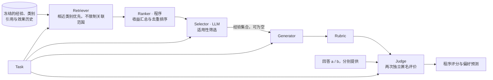
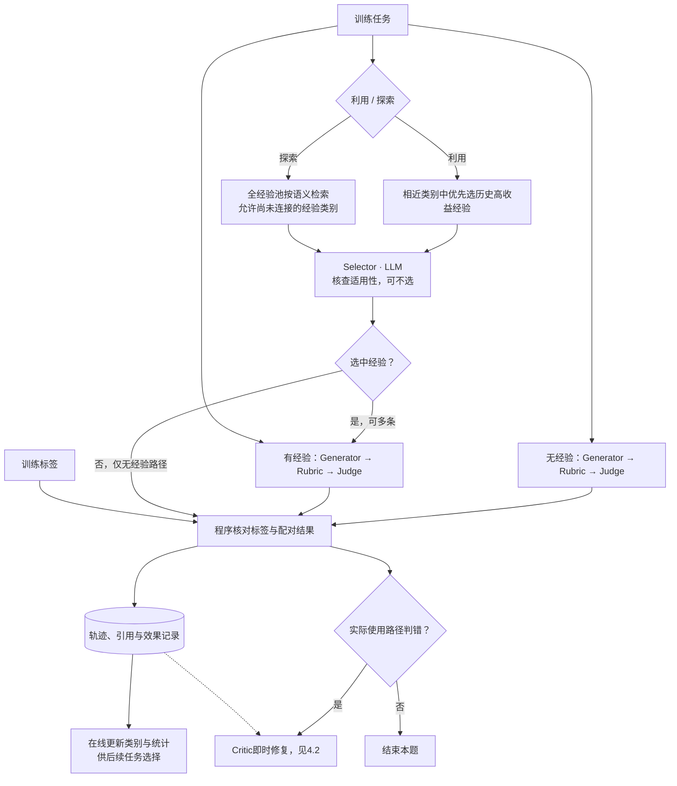
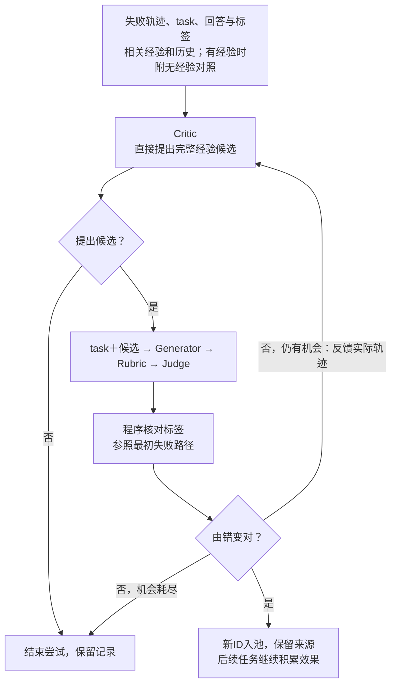

# VERGE 方法设计

2026-11-07 · 设计稿，尚未实现。本文说明整体方法；聚类公式与伪代码见[算法109](研究讨论/109-混合相似度在线聚类算法.md)，研究依据见[调研108](研究讨论/108-任务经验在线聚类算法调研.md)。

## 1. 研究目标与总体架构

VERGE通过历史任务反馈积累评分标准设计经验，学习任务与经验的适用关系，改善新任务上的偏好评判。基础大模型参数固定；训练更新经验池、任务与经验分组、引用关系及效果统计。

执行主干为：**检索相关任务类别 → 按历史效果排序经验 → 筛选适用经验 → 生成Rubric → 评判回答。**训练增加无经验对照、经验生成与历史更新，推理使用冻结状态。

各环节都可能出错，因此以实际运行结果检验经验，不要求先准确定位错误模块，也不将模型解释或单次成功视作可靠性证明。

## 2. 数据模型与反馈定义

### 2.1 经验与历史记录

| 对象 | 核心内容 |
|---|---|
| 经验 | 适用范围、核心核验方法、生成指南；经验ID及来源 |
| 轨迹 | task、提供及实际引用的经验集合、Rubric、两侧Judge判断与理由、预测、执行设置和错误 |
| 引用关系 | 具体任务—经验之间的边，重复引用去重；类别关系由个体汇总 |
| 类别 | 任务组、经验组及成员；每个对象单一归属 |
| 效果记录 | 同题有／无经验结果、输入经验集合、证据量及来源／下游用途 |

每题可使用多条经验。Critic基于已有经验的任何改写都作为独立新候选，不管理新旧版本、不继承效果；来源关系仅用于追溯。已入池正文不原位覆盖，聚类不自动合并正文。

经验不含来源答案或标签，暂不加入Judge指南。检索曝光、提供与实际引用分别保存；未运行的组合保持未知。

### 2.2 同题反馈

| 无经验路径 | 有经验路径 | 反馈 |
|---|---|---|
| 错 | 对 | 改善，+1 |
| 对 | 错 | 退化，−1 |
| 对 | 对 | 均对，0 |
| 错 | 错 | 均错，0 |

技术失败单列，不计有效0收益。保留原始分数、判定和证据来源；即时修复及参与修改的案例属于开发证据，不计独立下游支持。

单经验记录可计算`净收益率 = (改善次数−退化次数)/有效配对任务数`，并展示证据量。多经验路径只直接观测到组合效果，如何用于单条经验排序仍待确定，不能将组合收益复制为各成员的独立贡献。

## 3. 推理流程与经验选择



1. 新任务用文本向量检索多个相近任务组；历史单一归属不限制查询多个组。
2. 根据组内历史效果形成经验排序，相近组参考权重更高；经验与原始轨迹分别去重。类别联系只影响优先级，不作为硬过滤条件，未建立联系不代表不适用。
3. Selector结合task核查适用性，选择多条经验或不选；保留选择／使用说明以便追溯。
4. Generator生成Rubric，Judge分别评判两份回答，程序计算最终偏好。

**可见性约束：**Selector与Generator不看候选回答或标签；Generator不看Critic诊断或对照Rubric。每次Judge只看task、同一Rubric和当前匿名回答，不看另一回答、经验正文或偏好标签。

推理不探索、不触发Critic、不更新分组。没有相近类别时，可回退直接检索历史记录或不用经验，具体回退规则待定。

## 4. 训练流程与经验生成

### 4.1 对照运行与历史更新



有经验时运行两路，无经验时仅一路；不按经验数量增加路径。实际路径是本次选择经验后的路径，未选经验则是无经验路径。纯技术失败先处理执行异常，不直接触发内容修订。

本题选择读取开始时的历史，完成后再更新。训练区分两种选择：

- **利用：**优先参考相近任务类别中的历史高收益经验。
- **探索：**从整个经验池按当前任务的语义相关性检索，允许没有既有任务类—经验类联系的经验进入候选；不能仅在原关联组内探索低证据经验。

两者都经LLM核查适用性，允许不选；实际运行后保存新的引用和效果，更新类别联系。探索改变候选来源，不额外增加执行路径。80%利用／20%探索仍是建议初值。第一版不专设退出机制，低收益经验通过排序与筛选减少使用。

### 4.2 Critic即时验证与准入



Critic统一负责从零提出经验或参考已有经验改写，允许不提候选；不先修改Rubric再提炼，也不自行更正Judge结果来认定成功。诊断仅作为提案依据，不要求可靠定位失败字段。

候选经实际Generator、Judge运行，由错变对才通过，margin增大但仍错不算通过；参照不随重试改变。所有草稿与失败留档。候选验证先检查其自身作用，若携带其他经验须另定输入规则并记录完整集合。

通过即可入池，无额外版本验证、升级或三路比较，也不在入池后重复同一次来源运行。入池表示允许尝试，可靠性仍依赖后续任务；修复来源题不证明泛化。

## 5. 在线聚类算法

任务和经验分别分组，采用相同规则。新旧对象都结合语义向量与具体引用集合，不增加LLM分类调用。完整伪代码见[109第6节](研究讨论/109-混合相似度在线聚类算法.md#6-伪代码)。

### 5.1 混合相似度

对同类型对象x、y，令T为余弦相似度裁剪到[0,1]，J为引用集合Jaccard相似度：

```text
m = 两个引用集合大小的较小值
w = λ_max × m/(m+1)
S(x,y) = (1−w)×T + w×J
```

任一集合为空时直接用T。引用越少，权重越低；该权重是候选规则，不是可靠性概率。共同引用可能是互补或选择偏差，不证明经验等价。

### 5.2 分组与在线调整

- 对象到组的得分为它与组内其他成员S的平均，排除自身。
- 新对象加入得分最高且达到门槛的组；无达标组则独立新建，不预设组数。
- 其他组得分达标且严格高于当前组时换组；当前多成员组不达标且无其他达标组时独立成组。单成员留组分数按门槛计，平分不换组。
- 本轮引用固定，按稳定ID检查所有对象；移动后立即更新成员。整轮无换组停止，否则继续，最多5轮；触顶仍有移动则标记未稳定。
- 原始边去重保存，成员变动后重汇总组间关系与效果，不将本题未来记录用于事前选择。正式推理冻结分组。

每个历史任务只属一组，经验侧也采用普通单组组织；任务类与经验类之间允许多对多。查询按组成员平均相似度参考多个任务组，不改变唯一归属。

## 6. 参数、设计边界与实施状态

| 项目 | 当前设置／状态 |
|---|---|
| 引用最大权重λ_max | 建议初值0.3，待验证 |
| 任务／经验门槛τ_task、τ_exp | 各建议0.75，独立配置，待验证 |
| 在线更新上限R_max | 用户确认暂设5轮，允许提前停止 |
| 查询任务组数 | 建议最多3个达标组，待验证 |
| 探索 | 已确认允许全池语义检索与跨类别新联系；80／20比例及具体调度待定 |
| 仍待设计 | 多经验组合收益如何支持单条排序、类别证据加权、无覆盖回退、Critic候选与重试预算、平分及技术失败协议 |

引用与聚类不替代效果检验，标签和LLM均可能有噪声；贝叶斯只在有明确作用且值得复杂度时引入。当前算法仅做公式算例检查，真实分组质量、稳定性、成本及最终收益均未验证。

新方法尚未实现。现有代码为提交`eaf9137`保存的[旧实现](历史设计/2026-11-06-旧实现/README.md)，历史实验不作为新方案效果证据。研究进度见[PLAN](../PLAN.md)和[看板](研究进度.html)；旧HTML图中的版本流程已失效，以本文为准。
