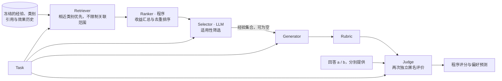
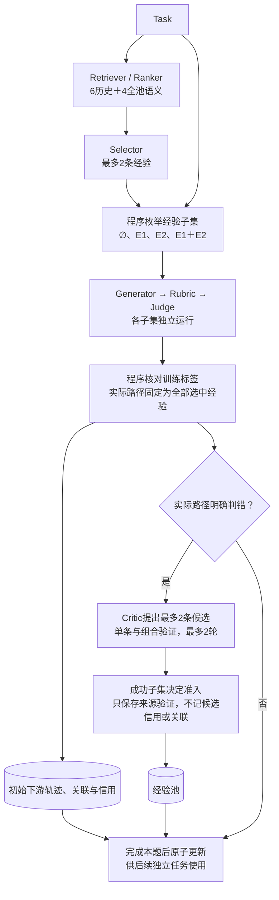

# VERGE 方法设计

2026-11-13 · 本文主体记录v3已实现的方法，500题实测未显示净收益，见[报告120](实验分析/120-General500题四路流程实测.md)。下一版v3.1的[聚类修改](设计方案/v3.1-聚类修改暂定方案.md)与[Critic修改](设计方案/v3.1-Critic修改暂定方案.md)已暂定，均未实现。v3聚类公式与伪代码见[算法109](研究讨论/109-混合相似度在线聚类算法.md)，研究依据见[调研108](研究讨论/108-任务经验在线聚类算法调研.md)。

## 1. 研究目标与总体架构

VERGE通过历史任务反馈积累评分标准设计经验，学习任务与经验的适用关系，改善新任务上的偏好评判。基础大模型参数固定；训练更新经验池、任务与经验分组、提供关系及效果统计。

执行主干为：**检索相关任务类别 → 按历史效果排序经验 → 筛选适用经验 → 生成Rubric → 评判回答。**训练增加无经验对照、经验生成与历史更新，推理使用冻结状态。

各环节都可能出错，因此以实际运行结果检验经验，不要求先准确定位错误模块，也不将模型解释或单次成功视作可靠性证明。

## 2. 数据模型与反馈定义

### 2.1 经验与历史记录

| 对象 | 核心内容 |
|---|---|
| 经验 | 适用范围、核心核验方法、生成指南；经验ID及来源 |
| 轨迹 | task、各子集实际提供的经验集合、Rubric、两侧Judge判断与理由、预测、执行设置和错误 |
| 引用关系 | 后续独立任务—经验之间的提供边，重复去重；类别关系由个体汇总 |
| 类别 | 任务组用于汇总效果、选择经验；经验组仅用于分析，各对象单一归属 |
| 效果记录 | 同题有／无经验结果、输入经验集合、证据量及来源／下游用途 |

每题最多提供两条经验。Critic基于已有经验的任何改写都作为独立新候选，不管理新旧版本、不继承效果；来源关系仅用于追溯。已入池正文不原位覆盖，聚类不自动合并正文。

经验正文不得包含来源答案或标签，暂不加入Judge指南；模型仍可能违例，格式检查不代表内容可靠。检索曝光与实际提供分别保存；未运行的组合保持未知。

### 2.2 四路反馈与信用

Selector最多选择两条经验。训练提供无经验、仅E1、仅E2、E1＋E2四种输入；只有一条时运行两路，没有经验时一路。全部选中经验构成事前固定的实际路径，其他路径只作对照，不按标签挑选初始结果。Generator只输出设计分析与Rubric标准，不声明经验引用或使用情况。

令r₀、r₁、r₂、r₁₂为各路最终判断与训练标签一致的结果（对1、错0）：

```text
c₁ = ((r₁ − r₀) + (r₁₂ − r₂)) / 2
c₂ = ((r₂ − r₀) + (r₁₂ − r₁)) / 2
```

一条时c₁＝r₁−r₀。信用按提供经验计算；每题每条只记一次，任务组内汇总平均信用与证据量，新任务仍按任务组相似度加权。保留全部子集轨迹和共同提供集合。技术失败不补0，四路不完整时不计完整双经验信用；未知不等于0。单次差异含模型波动，不认证经验正确或内部使用过程。

来源验证只判断准入，不计算或保存候选信用，不建立候选关联。新经验入池时信用未知、关联为空，后续独立任务才积累证据。既有经验在当前任务的初始运行仍可获得正常下游反馈；Critic新候选不借用它的来源结果。

### 2.3 聚类关联

关联为后续独立任务经Selector选中、实际提供给Generator的任务—经验边，不依赖自报引用，不论判对判错。仅检索未选中不建边；同题多路、重试不重复计边。Critic来源验证和重试不为新候选建边，入池后也不补来源边。完整规则见[计划119](plans/119-四路验证与统一信用分配.md)。

## 3. 推理流程与经验选择



1. 新任务用文本向量检索多个相近任务组；历史单一归属不限制查询多个组。
2. 先计算每个相近任务组内单条经验的平均信用，再按新任务与各组的相似度加权，得到每条经验的一个分数。证据量另存，不额外乘进组权重；经验组不参与候选筛选或收益排序。
3. Selector结合task核查适用性，选择最多两条经验或不选；保留选择理由与提供集合以便追溯。
4. Generator生成Rubric，Judge分别评判两份回答，程序计算最终偏好。

经验E的排序计算为：

```text
u(g,E) = E在任务组g中的收益总和 / 有效任务数
score(task,E) = Σ similarity(task,g) × u(g,E) / Σ similarity(task,g)
```

只累加E有直接使用证据、且相似度大于0的查询任务组；无记录不是0收益，不参与分子或分母，全部未知则保留为待探索经验。同一经验最终只出现一次。组内任务先去重，再算组均值，不改为按样本量加权的原始记录平均。

**第一版不依赖经验组选择。**经验聚类保留为分析结果，不先选经验组、不用同组其他经验的效果替代E，也不自动合并经验正文。训练探索仍可覆盖全池，避免把候选锁在已建立联系的范围。候选配额采用下述6＋4规则。

**可见性约束：**Selector与Generator不看候选回答或标签；Generator不看Critic诊断或对照Rubric。每次Judge只看task、同一Rubric和当前匿名回答，不看另一回答、经验正文或偏好标签。

候选来自两部分：相近任务组中的历史收益排序，以及全经验池语义检索。**没有达标任务组时，候选全部来自全池语义检索**，对应历史收益仍为未知。候选最多10条：先取6条历史收益排序，再取不重复的全池语义候选；历史不足6条或去重后不足10条，继续用语义候选补齐。无达标任务组时最多取10条语义候选；池内不足10条返回实际数量。最终都由Selector核查，可全部拒选。推理不积累探索反馈、不触发Critic、不更新分组。

## 4. 训练流程与经验生成

### 4.1 对照运行与历史更新



有两条经验时运行四路，一条运行两路，无经验运行一路；候选验证复用初始无经验基线。实际路径不按运行结果更换。技术失败保留未知，不触发内容修订。

本题选择读取开始时的历史，完成后再更新。训练结合两种候选来源，而不是将经验组作为硬边界：

- **利用：**优先参考相近任务类别中的历史高收益经验。
- **探索：**从整个经验池按当前任务的语义相关性检索，允许在相关任务组中没有使用记录的经验进入候选；不能仅在已有关联范围内探索低证据经验。

两种候选交给同一个Selector核查适用性，允许不选；实际运行后保存新的提供关联和信用，更新任务—经验联系。没有达标任务组时全部走全池语义检索，不强行降低聚类门槛。两种检索来源共用同一候选池与子集验证；混合候选采用已确认的10条上限、6条历史＋4条语义，缺额由语义补齐。第一版不专设退出机制，低收益经验通过排序与筛选减少使用。

### 4.2 Critic即时验证与准入

本节为v3实现。v3.1拟加入人工偏好理由，并在提案前核对Rubric缺陷、允许依据不足时放弃；见[Critic暂定方案](设计方案/v3.1-Critic修改暂定方案.md)，此次未调整准入规则。

实际路径明确判错时触发Critic，初始所有子集轨迹作为参考；技术失败不作为内容失败。Critic直接提出经验，不先修改Rubric、不自行更正Judge结果。

每轮最多2条、最多2轮。候选单条与组合分别运行Generator和独立双侧Judge，复用无经验对照，不携带旧经验或原Rubric。至少一个非空候选子集判对即修复成功：单条判对则该条准入；两条单独均错、组合判对则一起准入。组合判对而单条技术失败时可按组合准入，保留单条未知。候选通过后结束本题；全部失败且仍有预算时反馈真实轨迹再提案。

来源只保存结果和准入依据，不计算候选收益、不建聚类关联；入池表示允许后续尝试，不证明泛化。共同成功的候选保留独立ID及组合记录，不自动合并正文或捆绑后续选择。不在入池后重复来源运行。

## 5. 在线聚类算法

本节记录v3当前实现；v3.1拟改为对侧类别分布与交替更新，详见[暂定方案](设计方案/v3.1-聚类修改暂定方案.md)。

任务和经验分别分组，采用相同规则。新旧对象都结合语义向量与具体引用集合，不增加LLM分类调用。完整伪代码见[109第6节](研究讨论/109-混合相似度在线聚类算法.md#6-伪代码)。

### 5.1 混合相似度

对同类型对象x、y，令T为余弦相似度裁剪到[0,1]，J为引用集合Jaccard相似度：

```text
m = 两个引用集合大小的较小值
w = λ_max × m/(m+1)
S(x,y) = (1−w)×T + w×J
```

任一集合为空时直接用T。引用越少，权重越低；该权重是候选规则，不是可靠性概率。共同引用可能是互补或选择偏差，不证明经验等价。

### 5.2 分组与在线调整

- 对象到组的得分为它与组内其他成员S的平均，排除自身。
- 新对象加入得分最高且达到门槛的组；无达标组则独立新建，不预设组数。
- 其他组得分达标且严格高于当前组时换组；当前多成员组不达标且无其他达标组时独立成组。单成员留组分数按门槛计，平分不换组。
- 本轮引用固定，按稳定ID检查所有对象；移动后立即更新成员。整轮无换组停止，否则继续，最多5轮；触顶仍有移动则标记未稳定。
- 原始边去重保存，成员变动后重汇总组间关系与效果，不将本题未来记录用于事前选择。正式推理冻结分组。

每个历史任务只属一组，经验侧也采用普通单组组织，其分组只作分析；任务类与经验类的多对多联系不作为选择前提。查询按组成员平均相似度参考多个任务组，不改变唯一归属。

## 6. 参数、设计边界与实施状态

| 项目 | 当前设置／状态 |
|---|---|
| 关联最大权重λ_max | 暂设0.5，待验证 |
| 任务／经验门槛τ_task、τ_exp | 各建议0.75，独立配置，待验证 |
| 在线更新上限R_max | 用户确认暂设5轮，允许提前停止 |
| 查询任务组数 | 建议最多3个达标组，待验证 |
| 候选配额 | 最多10条：6历史＋4全池语义，去重后缺额由语义补齐；无匹配任务组时全语义 |
| 探索 | 全经验池语义检索，不受已有引用或经验组限制；语义候选不保证会被Selector采用 |
| Critic预算 | 每轮最多2条，最多2轮；单条及组合验证，有通过项即结束本题 |
| 准入 | 单条判对或仅组合判对；来源不记收益、不建关联 |
| 平分／失败 | margin必须严格大于0才判对；技术失败单列、不计0收益 |
| 并发与冻结 | 滚动5样本，完成后原子提交；全部案例及即时验证完成才冻结 |

关联与聚类不替代效果检验，标签和LLM均可能有噪声；贝叶斯只在有明确作用且值得复杂度时引入。当前协议已实现：193项程序测试、5个Node测试文件通过；Selector、Generator、Critic各20个历史真实输入独立复测最终结构通过，但经验过强、错误适用与候选不通用仍有实例。随后v3完成的[500题实测](实验分析/120-General500题四路流程实测.md)未显示净收益；v3.1聚类与Critic方向仅暂定，尚无实现或验证结果。实现与限制见[报告119](实验分析/119-四路信用与来源排除实现验证.md)，研究进度见[PLAN](../PLAN.md)和[看板](研究进度.html)。
