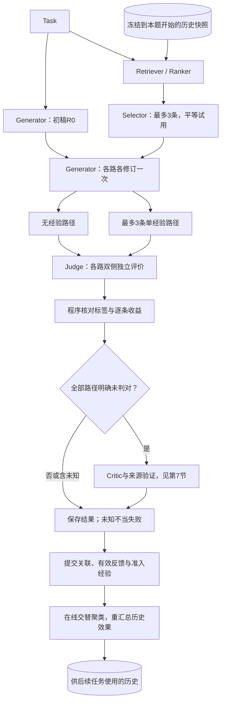

# VERGE v3.1设计方案

2026-11-13 · 方法规范。本文独立定义VERGE v3.1，无需先阅读旧版本。设计尚未实现或实测；当前代码状态及工程安排见[工程设计](工程设计.md)与[PLAN](../PLAN.md)。

## 1. 问题定义与系统目标

VERGE（Verified Experience-guided Rubric Generation）用于评价同一任务的两份候选回答。系统先根据任务设计评分标准（Rubric），再逐项评价回答，汇总得到偏好预测。

训练数据包含任务、两份回答、人工偏好标签及可用的人工偏好理由。系统从失败轨迹中提出可复用的评分标准设计经验，通过实际应用记录它们在不同任务上的效果，使后续任务能够选择并应用适合的经验。

基础语言模型和嵌入模型参数固定。训练改变的是经验池、任务与经验的分组、实际提供关系及历史效果记录；推理使用冻结的这些状态。经验是评分方法，不是题目答案，也不能替任务增加输出义务。

系统需要支持三个连续环节：**为任务选择经验、利用经验设计标准、根据标准评价回答。**各环节可能有噪声，因此经验是否有帮助以运行结果持续检验，不要求先获得完全可靠的模块归因。

## 2. 输入、输出与持久状态

### 2.1 任务样本与预测

| 场景 | 外部输入 | 输出 |
|---|---|---|
| 训练 | task、chosen／rejected回答、人工偏好标签、人工理由（如有） | 各路Rubric与判断、逐条经验信用、候选经验及准入结果、更新后的历史状态 |
| 推理 | task、匿名回答A／B、冻结历史 | 最多一条所选经验、Rubric、双侧逐项判断及得分、偏好预测或平局 |

chosen／rejected仅表示训练偏好方向。对执行Judge只暴露当前匿名回答，不暴露其偏好身份；程序最后再核对训练标签。技术错误产生未知状态，不能伪装为平局或判错。

### 2.2 经验表示

每条经验围绕一个核心核验方法，包含以下内容：

| 字段 | 含义 |
|---|---|
| `experience_id` | 稳定的独立编号 |
| `trigger` | 仅凭未来task可判断的适用条件 |
| `principle` | 可复用的核心核验方法 |
| `application_guide` | Generator怎样把方法落实为标准，以及必要边界 |
| `source_task_id` | 提出该经验的来源任务 |
| `parent_ids` | 可选的参考经验编号，仅用于追溯 |

经验不包含Judge指南、来源答案特征、偏好标签或绑定来源案例的固定写法。Critic参考旧经验作出的任何改写都是独立新经验，不覆盖原文、不继承旧经验效果、不管理同一经验的多版本竞争。聚类不自动合并正文。

### 2.3 Rubric与历史

Rubric包含设计分析及若干标准。每条标准有编号、明确的通过问题`question`和非负有限权重`weight`，权重总和为1；满足问题所述要求时应判true。Generator不输出经验引用或使用声明，程序直接记录给模型提供了哪条经验。

持久状态由四部分组成：

- **经验池：**已准入经验及来源关系。
- **关联与类别：**任务和经验的固定文本向量、去重提供边及唯一分组归属。
- **反馈账本：**后续独立任务上的有／无经验结果、逐条信用、有效任务数和未知原因。
- **执行轨迹：**任务与回答、召回候选与分数、选择理由、初稿与修订稿、Judge原判、Critic分析及验证、模型设置和全部技术错误。

关联和收益分开保存。“曾提供过经验”不等于该经验有效；没有效果记录也不等于收益为0。

## 3. 系统架构与信息可见性

程序负责召回排序、并发调度、得分汇总、标签核对和历史更新。Selector、Generator、Judge、Critic由固定模型执行。

| 组件 | 输入 | 职责与输出 |
|---|---|---|
| Retriever／Ranker | task向量、类别、经验池、历史收益 | 产生有排序依据的经验候选列表 |
| Selector | task、候选正文、历史分数及证据量 | 核查适用性，返回所选编号及依据；训练最多3条，推理最多1条 |
| Generator初稿 | 仅task | 生成任务自身的Rubric初稿R0 |
| Generator修订 | task、R0、本路零条或一条经验 | 生成该路最终Rubric |
| Judge | task、最终Rubric、当前一份匿名回答 | 各标准的布尔判断及具体理由 |
| Critic（仅训练） | 完整轨迹、回答、偏好标签与人工理由 | 分析失败依据，提出零条或一条评分标准设计经验 |

Selector与两个Generator阶段都不读取候选回答、标签或人工偏好理由。Judge不读取另一回答、经验正文或Critic分析。人工理由只进入训练Critic，不直接帮助候选验证中的Generator或Judge判对。

训练和推理的共同主干为：**召回排序 → 选择经验 → 生成初稿 → 修订标准 → Judge → 程序汇总。**训练通过多条独立单经验路收集效果，推理只执行选择后的一路，不需要训练标签。

## 4. 经验检索与选择

### 4.1 检索相近任务组

将task原文转换为固定嵌入向量，以裁剪到[0,1]的余弦相似度计算新任务与历史任务的相似度。新任务与某任务组的分数为它与该组成员的文本相似度平均。取达到任务查询门槛的相近组，最多参考3组；查询不要求新任务先具有经验关联，也不修改其归属。

历史任务各只有一个所属组，但查询可同时参考多个组。组是组织历史证据的工具，不是预先给定的任务标签，也不保证同组收益可无误迁移。

### 4.2 历史收益排序与全池候选

对经验E，先按每个相关任务组内的不同有效任务统计均值，再按新任务与各组的相似度加权：

```text
u(g,E) = Σ_{t∈g且E有有效反馈} c(t,E) / 有效任务数
score(q,E) = Σ_{g∈G_E(q)} sim(q,g) × u(g,E) / Σ_{g∈G_E(q)} sim(q,g)
```

G_E(q)只包含本次查询命中、相似度大于0、且E有直接效果证据的组。没有证据的组不进入分子或分母；集合为空则分数未知。保留不同任务数，但不额外将它乘进组权重，不用同经验类其他成员的收益代替E的收益。

最多召回10条候选：优先取最多6条历史收益排序的经验，再由全经验池语义检索补足。正常情况下是6历史＋4语义；去重后不足、历史不足6条时继续用语义补齐。无达标任务组时最多10条全部走全池语义，历史分数未知；经验池不足时返回实际数量。

全池语义入口允许尚未在相关任务组用过的经验进入候选，避免检索局限在已有关系内。经验组不作为候选硬边界，不按经验组收益选经验。

### 4.3 Selector决策

Selector对照task与经验的适用条件，选择有依据的经验。主题相关不代表前提成立，选中也不表示经验中待核验的条件已经成为本题事实。

训练最多选择3条不同经验，三条平等试用，不区分首选与探索；推理最多选择1条。均允许少选或不选，不为凑数选择。最终由Selector决定，程序不在其后重新指定“最优经验”，也不设置历史收益必须大于0的硬门槛。选择理由与全部候选分数留存，用于检查反馈是否真正影响选择。

## 5. Rubric生成与回答评判

### 5.1 生成任务初稿

Generator只根据task生成R0，明确交付对象、任务范围、数量及允许的形式，区分背景与需要回答完成的内容。初稿独立于所选经验，作为本题所有路径的共同起点。R0不直接作为无经验最终标准，也不被视为正确真值。

### 5.2 按路径修订

每条路径读取task、同一R0及本路经验输入，修订一次：

| 路径 | 修订输入 | 最终标准 |
|---|---|---|
| 无经验 | task＋R0 | R∅ |
| E1 | task＋R0＋E1 | R1 |
| E2 | task＋R0＋E2 | R2 |
| E3 | task＋R0＋E3 | R3 |

选k条经验就有k＋1条训练路径，最多四路，各路经验数不超过1；不存在组合路径。各路使用相同修订指令和设置，仅经验输入不同。未选经验时也执行无经验修订。

修订可纠正初稿的错误或遗漏；经验不适用时可保留原内容。每项修改需由任务或合理评价依据支持，不能因经验提到某种格式、写法或步骤就变成强制义务，也不能缩小原要求或把背景变成回答义务。最终标准完整确定后，按任务重要性分配权重。

### 5.3 Judge与程序得分

每路分别对两份匿名回答调用Judge。Judge逐项返回`satisfied`和理由，程序使用同一Rubric的权重计算：

```text
score(a,R) = Σ_j weight_j × I(a满足标准j)
margin = score(chosen,R) − score(rejected,R)
r = 1 当margin > 0；否则r = 0
```

训练中平局与反向排序都记未判对，但轨迹保留二者区别。推理输出A／B得分和偏好，得分相等则平局。网络、格式或模型合同失败记未知，不补成r＝0。

Judge应执行当前标准，而不是临时替换成另一套要求。即使准确执行了有缺陷的Rubric，也不能据此认定Rubric合理。Judge误判仍可能污染反馈，本方案不声称能够完全消除。

## 6. 训练流程与信用更新

### 6.1 每题执行



本题始终根据开始时的历史选择；完成后才提交本题新增经验、提供边和反馈，不让后验结果影响本题事前候选。

### 6.2 逐条信用

每条入池经验独立与同题无经验路径比较：

```text
c(t,E_i) = r(t,E_i) − r(t,∅)
```

信用为＋1（改善）、−1（退化）或0（同对／同错）。配对任一路未知，该条信用未知；其他有效配对仍可保存。每题每经验只计一次，路径重试不增加证据数，三个分支共享基线不等于三个独立任务。

三条训练经验没有“本题实际首选”。分别保留结果及是否存在成功分支，不事后用标签挑一条当作推理结果；“至少一路成功”是训练试用覆盖率，不是单路推理准确率。

### 6.3 提供关联与历史提交

后续独立任务实际向Generator提供过的入池经验形成一条任务—经验边。最多三条分别试用时都记录边，同一任务—经验去重；检索曝光但未选中不记录。路径判对、判错或技术未知均不将“已提供”改写为“未提供”；效果状态另存。

新任务和准入经验加入历史对象，提交后按第8节更新分组。收益账本保留原始任务ID，任务换组后重新汇总当前组内统计，而不复制或丢弃原始反馈。

## 7. Critic与经验生命周期

### 7.1 触发条件

| 初始路径结果 | 是否调用Critic |
|---|---|
| 任一路成功，包括无经验 | 否 |
| 无经验成功，所有经验路失败 | 否；各有效配对记录−1 |
| 所有路径均明确未判对 | 是 |
| 没选经验，无经验明确未判对 | 是，支持空池冷启动 |
| 无成功，但存在技术未知 | 不满足“全部明确失败”；技术续处理见第10节 |

触发仅表示需要分析，不保证产生候选。

### 7.2 分析与提案

Critic在一次调用内完成以下过程：

1. 结合task、两份回答、人工偏好理由理解评价依据。
2. 检查选择前提、Generator初稿与修订、Judge判断及理由，指出具体文本依据。
3. 决定能否提炼可复用的适用边界或核验方法；有依据才提出候选，无法可靠归因时不提案。

允许多个环节同时出错，不要求证明唯一原因。只有Judge读错、漏看或算错而无可提炼的评分标准问题时，不生成经验；不能靠改变标准迎合错误执行。Critic不修改Rubric、不自行更正Judge结果来宣布成功。

人工偏好理由使用HelpSteer3的`individual_preference[].reasoning`，根据原始回答顺序正确映射到chosen／rejected。不同标注者的分歧保留，理由须与task及回答原文核对；受赞的具体写法不自动成为通用必要条件。缺失或依据笼统时不能编造支持。

### 7.3 即时验证与准入

每轮最多提出1条候选，最多2轮，可以0条结束。候选作为单独经验进入Generator与Judge实际验证，执行角色看不到Critic诊断、训练标签或人工理由；Critic不直接判定自己提案有效。

候选判对且完成必要的结构、存储准备后入池，成功即结束；明确未判对且仍有预算时，将真实验证轨迹反馈Critic重新分析。两轮候选不组合。候选如何复用本题初稿及技术未知分支仍需实现前明确，不能换基准制造改善。

### 7.4 准入后的维护

候选从提出到准入或拒绝的全部轨迹都保留。准入表示允许未来使用，不认证方法正确或泛化有效。

**来源验证不为候选计算信用、不建立来源任务关联。**入池时历史效果未知、关联为空；后续独立任务选择并实际提供它后，才建立边并积累信用。来源与parent仅用于追溯，不传递收益。

经验池保留独立经验，不设置自动退出、强制合并或版本继承机制。后续选择参考任务条件下的收益及适用性；负收益不是永久禁用，低证据不是零收益。

## 8. 任务—经验双向在线聚类

### 8.1 类别关联表示

每个任务和每条经验各属于一个组，任务类与经验类可以多对多关联。文本向量固定：任务使用task，经验使用三字段正文，不输入回答、标签或收益。

具体提供边是原始依据，类别关联由其汇总。对任务，统计所选经验分别属于哪些经验类；对经验，统计使用它的不同任务分别属于哪些任务类。归一化得到分布：

```text
n_x(g) = x关联到对侧类别g的不同对象数
p_x(g) = n_x(g) / Σ_h n_x(h)
J_group(x,y) = Σ_g min(p_x(g),p_y(g)) / Σ_g max(p_x(g),p_y(g))
S(x,y) = (1−w) × T(x,y) + w × J_group(x,y)
```

T为文本余弦相似度裁剪到[0,1]；任一对象无关联时只用T。分布描述使用模式，计数与证据量另存，不是适用概率或收益。相近使用分布可以支持同组，但误选也会产生关联，不能直接认定为正确适用。

### 8.2 最低约束与整体分组目标

任务和经验分别使用最低阈值τ_task、τ_exp，不预设组数。单成员始终合法；多成员组要求每个成员与其他成员的平均混合相似度均不低于本侧τ：

```text
a(x,C) = Σ_{y∈C,y≠x} S(x,y) / (|C|−1)
合法(C) = [|C|=1] 或 [对所有x∈C，a(x,C)≥τ]
```

阈值只拒绝明显不合适的归组，不决定最终组数；达到门槛仍不自动加入。比较合法划分的整体目标采用经典加权模块度：

```text
A_ij = S(i,j)（i≠j）；A_ii = 0
k_i = Σ_j A_ij；2m = Σ_i k_i
Q(P) = Σ_ij [A_ij − k_i*k_j/(2m)] × I(i,j同组) / (2m)
```

固定分辨率γ＝1，保留全部相似度权重，不按τ截断矩阵。搜索对象移动、独立成组和组间合并；操作必须保持受影响组合法，并使ΔQ>0。合并还需跨组平均相似度达标。没有合适操作就保留现状，包括单成员；不为减少组数强制吸收。

已有划分、全单成员和合法时的全同组可作为搜索起点，最终取Q较高的合法结果。平分保持现状或按稳定成员ID规则确定，不依赖偶然组编号。旧组在新矩阵下不合法时先移出最弱成员修复，修复优先保证低限，不要求Q上升。

### 8.3 在线交替更新

首先用文本建立初始类别；在线保留已有类别，用文本初始化新对象。每轮先固定经验类别更新任务分布、矩阵与分组，再固定新的任务类别更新经验侧。每个半轮先修复合法性，再优化；固定矩阵下分数才可比较。

两侧归属不变则稳定；检测重复划分时记cycle，最多5轮触顶仍变化时记未稳定。对侧变化会使先更新的一侧约束变旧，只有稳定状态才保证两侧都使用当前对侧检查过；未稳定结果保留半轮矩阵版本与检查状态，不能伪称收敛或完全同步。

同一训练任务最多3条分别试用的经验边不表示组合有效。类别变动后按原始任务ID重新汇总收益，不自动合并正文、不继承同类收益。新任务仍按文本查询历史组，查询门槛与分组低限是不同参数。

该搜索不保证全局最优或唯一正确分组；平均低限也不保证组内每一对都强相关。阈值数值、混合权重和计算预算仍需明确，不能将固定0.75当成新低限。完整操作公式、伪代码与边界见[在线聚类](设计方案/01-在线聚类.md)。

## 9. 冻结推理与验证口径

训练任务和即时验证结束、状态完整保存后冻结经验池、组、关联和反馈。推理先按第4节召回与Selector选择，再生成初稿、修订一次、双侧Judge并返回预测；无经验时同样走完整生成评判流程。推理不调用Critic，不积累信用或关联，不更新分组。

训练产物的效果需要由冻结推理验证。记录单路偏好准确率、平局与技术未知，同时检查历史收益候选及最终选择的覆盖、有效经验的后续证据量和聚类内容合理性。训练多路覆盖、来源准入率、组数减少或输出结构合法都不能替代总体效果。

需检查Rubric是否新增无据要求、遗漏任务、反向应用经验，以及Judge是否准确执行。开放判断保留不确定，模型复核不是独立真值。开发材料与冻结验证任务区分，不能在验证集上调优后声称独立泛化。

## 10. 参数与尚未完成的决策

以下未定项不表示旧实现没有设置。v3已有权重调节、0.75门槛、固定ID逐个移动、平分保留、有限重试及检查点机制；需区分可讨论沿用的规则与共享初稿等新增问题，详见[已有设置核对](设计方案/03-v3已有设置核对.md)。

| 已确定的结构 | 设置 |
|---|---|
| 候选总数与来源 | 最多10条，6历史＋4全池语义，缺额语义补齐 |
| Selector数量 | 训练最多3条平等试用，推理最多1条，均可不选 |
| 任务组查询 | 最多3个达标组 |
| 生成 | 一个共享初稿，每路一次修订，无经验也修订 |
| 训练路径 | k条经验对应k＋1路，不作组合 |
| Critic | 所有路径明确失败才触发，每轮最多1条、最多2轮 |
| 聚类更新 | 最低相似度约束＋模块度优化，不预设组数；最多5轮，检测稳定及循环 |
| 新经验来源 | 仅准入，不记信用或关联 |

尚需明确：聚类w及证据量调节、两侧最低阈值的具体数值、搜索计算预算；初始化、半轮移动及平分规则已在聚类文档形式化；候选初稿复用、共享初稿失败和技术未知后的具体续处理；状态格式、检查点和执行参数。未定项不自动继承为已采用配置。

本方案不包含模型参数训练、经验组合使用、重复Judge投票或自动纠正。Judge噪声、Selector误选和来源过拟合仍可能存在；上述设计需要实现与实测，不能仅凭逻辑完整宣称有效。

文档导航：[模块输入输出](设计方案/02-模块与数据约定.md) · [工程设计](工程设计.md) · [历史设计](历史设计/2026-11-13-v3/README.md)。
